<div align="center">

# tmux-scroll-revamped

<strong>マウスホイールを、自分でスクロールするアプリへ送り、それ以外では tmux のコピーモードに入ります。</strong>

[English](README.md) &nbsp;|&nbsp; 日本語 &nbsp;|&nbsp; [简体中文](README.zh-Hans.md) &nbsp;|&nbsp; [繁體中文（香港）](README.zh-HK.md)

[](https://github.com/tmux-revamped/tmux-scroll-revamped/actions/workflows/ci.yml)
[](https://github.com/tmux-revamped/tmux-scroll-revamped/releases/latest)
[](https://scorecard.dev/viewer/?uri=github.com/tmux-revamped/tmux-scroll-revamped)
[](LICENSE)

<p align="center">
  <a href="#クイックスタート"><strong>クイックスタート</strong></a> &nbsp;|&nbsp;
  <a href="#使い方">使い方</a> &nbsp;|&nbsp;
  <a href="#判断のしかた">判断のしかた</a> &nbsp;|&nbsp;
  <a href="#画面">画面</a>
</p>

</div>

<p align="center">
  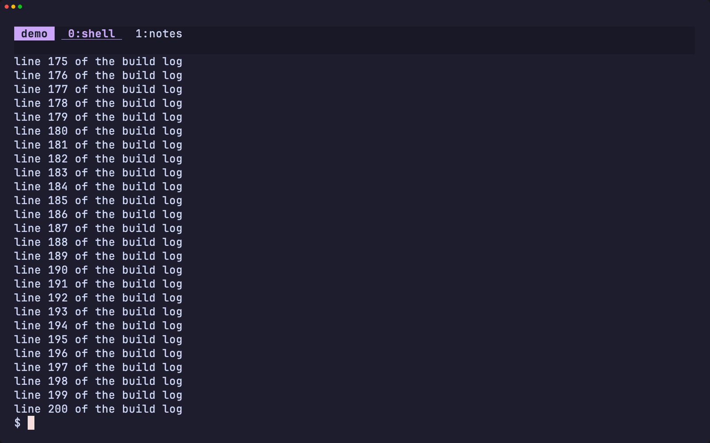
</p>

```console
$ scroll-revamped --wheel on list
set-option -g mouse on
bind-key -n WheelUpPane if-shell -F "#{?#{||:#{alternate_on},#{||:#{mouse_any_flag},#{pane_in_mode}}},1,0}" "send-keys -M" "copy-mode -e ; send-keys -M"
bind-key -n WheelDownPane send-keys -M
```

vim、less、htop、Claude Code のように代替画面で動く全画面アプリにはホイールがそのまま届き、マウスを求めたアプリにも届きます。シェルのプロンプトの上では、ホイールがコピーモードに入って tmux の履歴をスクロールします。判断は tmux のフォーマットで行うので、アプリを名指しせず、1 回のスクロールごとにプロセスも起動しません。

---

## クイックスタート

### 前提条件

| ツール | バージョン | 用途 |
|:-----|:--------|:---------|
| tmux | 3.2 以降 | ファミリー共通の最低バージョン。tmux 1.9 から 3.1 でも、判断のしかたに書いた代替手段で割り当てを組み立てます |
| クリップボードのツール | 任意 | `@scroll_revamped_drag_copy` 用。macOS では `pbcopy`、Linux では `wl-copy`、`xclip`、`xsel` |
| gum | 任意 | `scroll-revamped` のメニュー、表、色。なくてもすべてのコマンドがプレーンテキストで動きます |

### インストール

```tmux
set -g @plugin 'tmux-revamped/tmux-scroll-revamped'
set -g @scroll_revamped_wheel 'on'
```

続けて `prefix + I` を押します。TPM を使わない場合は、リポジトリをクローンし、`~/.tmux.conf` からエントリーポイントを実行します。

```bash
git clone https://github.com/tmux-revamped/tmux-scroll-revamped ~/.tmux/plugins/tmux-scroll-revamped
```

```tmux
run-shell ~/.tmux/plugins/tmux-scroll-revamped/scroll-revamped.tmux
```

クローンで `make install` を実行すると、`scroll-revamped` が `~/.local/bin` に、manページと補完が `~/.local/share` の下に入ります。

### 確認

```bash
~/.tmux/plugins/tmux-scroll-revamped/bin/scroll-revamped doctor
```

## 使い方

`@scroll_revamped_wheel` を `on` にしてスクロールします。vim、less、htop などの全画面アプリの上ではアプリがスクロールし、シェルのプロンプトの上では tmux の履歴がスクロールします。プラグインは tmux の `mouse` オプションも `on` にします。自分で管理するときは `@scroll_revamped_mouse` を `off` にします。

| コマンド | 動作 |
|:--------|:-------------|
| `scroll-revamped apply` | ホイールを今すぐ割り当てます。プラグインの読み込み時にエントリーポイントが実行します |
| `scroll-revamped list` | apply が行う割り当てをすべて表示します。`--json` で 1 つのオブジェクトを出力します |
| `scroll-revamped check ALT MOUSE HISTORY PANE` | tmux 2.0 より前で 1 回のスクロールを判断します。アプリへ渡すときは 0、コピーモードに入るときは 1 で終わります |
| `scroll-revamped doctor` | 依存関係ごとに 1 行。クリップボードのツールも含みます |
| `scroll-revamped version` | バージョンと tmux のバージョン |
| `scroll-revamped help` | ヘルプ。`man scroll-revamped` にも同じコマンドと設定があります |
| `scroll-revamped` | 端末ではメニュー |

| tmux オプション | 既定値 | 意味 |
|:------------|:--------|:--------|
| `@scroll_revamped_wheel` | `off` | `on` でホイールを振り分けるルートテーブルの `WheelUpPane` と `WheelDownPane` を割り当てます。`off` では tmux 自身のホイールのままです |
| `@scroll_revamped_passthrough_alternate` | `on` | 代替画面のアプリにホイールを渡します。`off` ではそのペインもコピーモードに入ります |
| `@scroll_revamped_passthrough_mouse` | `on` | マウスを求めたアプリにホイールを渡します |
| `@scroll_revamped_skip_empty` | `off` | `on` で履歴のないペインをコピーモードに入れません |
| `@scroll_revamped_select_pane` | `off` | `on` でスクロールの前にポインターの下のペインを選びます |
| `@scroll_revamped_alt_keys` | なし | `arrow` か `page` で、マウスを使わない代替画面のアプリ（less、man、vi など）にホイールを矢印キーかページキーとして送ります。矢印モードは 1 回につき `@scroll_revamped_speed` 個のキーを送り、未設定なら 3、最大 20 です |
| `@scroll_revamped_mouse` | `on` | `off` でプラグインは tmux の `mouse` オプションを変えません |
| `@scroll_revamped_speed` | なし | コピーモードで 1 回にスクロールする行数。正の整数です |
| `@scroll_revamped_granularity` | `line` | コピーモードで 1 回にスクロールする量。`line`、`halfpage`、`page` |
| `@scroll_revamped_auto_exit` | `off` | `on` で、最下部にいるときの下向きのスクロールでコピーモードを抜けます |
| `@scroll_revamped_indicator` | `off` | `on` でコピーモードのスクロールごとに位置（例 `scroll 120/4000`）を表示します |
| `@scroll_revamped_drag_copy` | `off` | `on` でコピーモードのマウス選択をシステムのクリップボードにコピーします |
| `@scroll_revamped_status_wheel` | `off` | `on` でステータスラインの上のホイールでウィンドウを切り替えます |

どのオプションも、ダッシュ区切りのコマンドオプション（例 `--skip-empty on`）と環境変数（例 `SCROLL_REVAMPED_SKIP_EMPTY`）で指定できます。優先順位はコマンドライン、環境変数、tmux オプションの順です。空の tmux オプションは既定値を意味します。2 つの passthrough オプションをどちらも `off` にすると、ホイールは常にコピーモードに入ります。

<a id="判断のしかた"></a>

## 判断のしかた

`WheelUpPane` は 1 つの条件を調べます。ペインが代替画面にあるか、アプリがマウスを求めたか、ペインがすでにモードにあるかです。成り立つときはホイールのイベントを `send-keys -M` でペインに送り、成り立たないときは `copy-mode -e` でコピーモードに入ります。このコピーモードは最下部まで戻ると抜けます。`WheelDownPane` は常にイベントを送るので、アプリか開いているコピーモードがスクロールします。

| tmux | 振り分け |
|:-----|:--------|
| 3.1 以降 | `#{\|\|:}` と `#{&&:}` の演算子を使う 1 つのフォーマット |
| 2.0 から 3.0 | 同じ条件を入れ子の `#{?}` で組み立てます |
| 1.9 | スクロールごとに `scroll-revamped check` を実行し、その答えをペインの状態ごとに `@scroll_revamped_cache_key` と `@scroll_revamped_cache_val` に保存します |

速度、粒度、自動終了、位置表示は tmux 2.4 以降で `copy-mode` と `copy-mode-vi` のテーブルのホイールを割り当て直します。位置表示には tmux 3.2、ステータスラインのホイールには tmux 2.1 が必要です。

<a id="画面"></a>

## 画面

<details>
<summary>すべての画面。本物の tmux の中で <code>make screens</code> で録画し、各マウス操作と押したキーをステータスラインに表示しています</summary>
<br>

<table>
<tr>
<td width="50%" valign="top">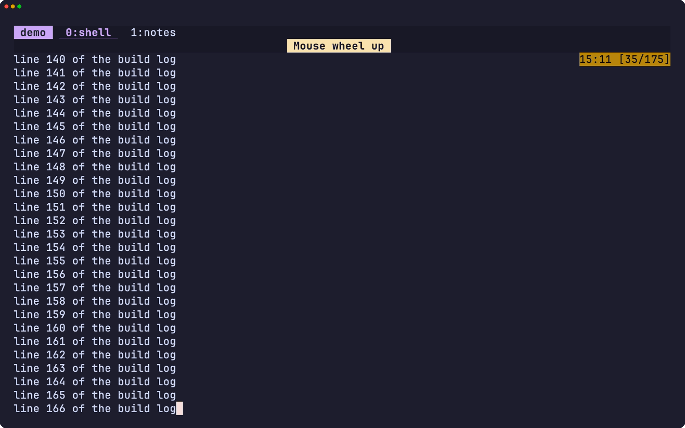<br><sub>シェルの上のホイールはコピーモードに入って履歴をスクロールする。<code>hero.tape</code>より</sub></td>
<td width="50%" valign="top">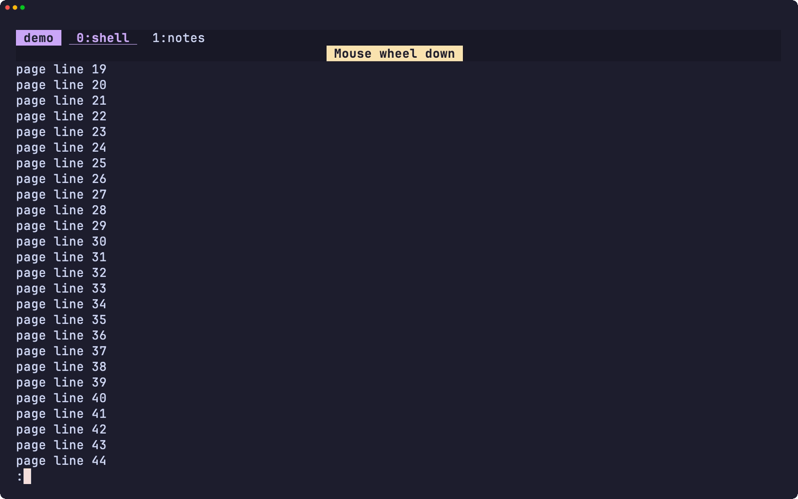<br><sub><code>@scroll_revamped_alt_keys arrow</code> で less は矢印キーでスクロールする。<code>hero.tape</code>より</sub></td>
</tr>
<tr>
<td width="50%" valign="top">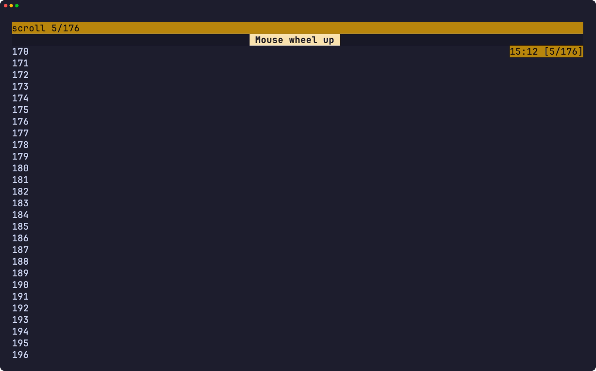<br><sub><code>@scroll_revamped_indicator</code> がスクロール位置を表示する。<code>hero.tape</code>より</sub></td>
<td width="50%" valign="top">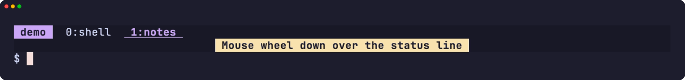<br><sub><code>@scroll_revamped_status_wheel</code> でステータスラインの上のホイールがウィンドウを切り替える。<code>hero.tape</code>より</sub></td>
</tr>
<tr>
<td width="50%" valign="top">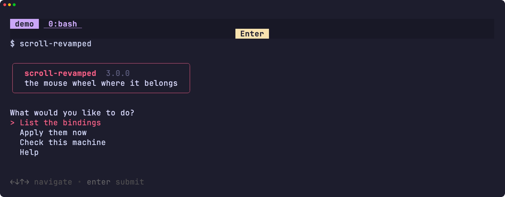<br><sub>メニュー。<code>stills.tape</code>より</sub></td>
<td width="50%" valign="top">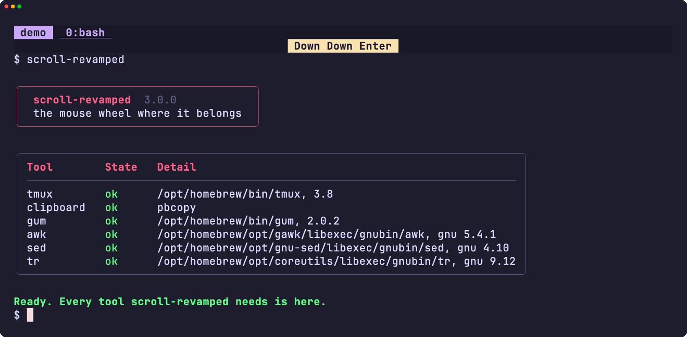<br><sub><code>doctor</code>。<code>stills.tape</code>より</sub></td>
</tr>
<tr>
<td width="50%" valign="top">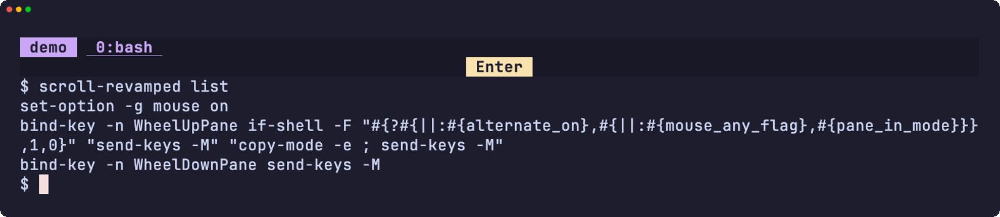<br><sub><code>list</code>。<code>stills.tape</code>より</sub></td>
<td width="50%" valign="top">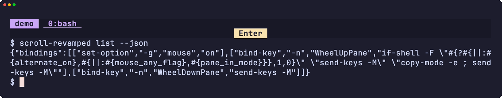<br><sub><code>list --json</code>。<code>stills.tape</code>より</sub></td>
</tr>
<tr>
<td width="50%" valign="top">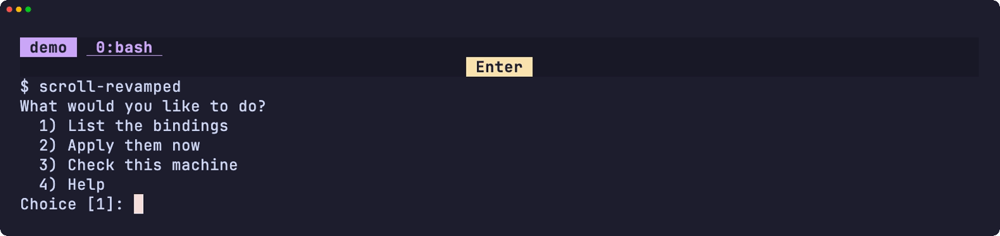<br><sub>gum なしのメニュー。<code>stills.tape</code>より</sub></td>
<td width="50%" valign="top">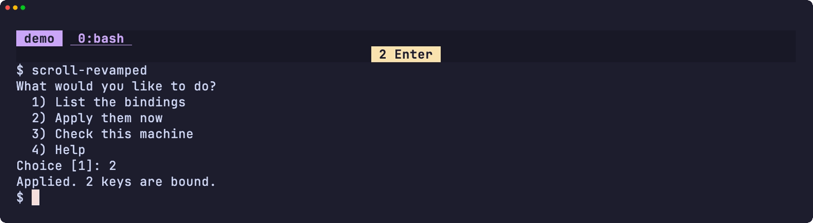<br><sub>メニューからの <code>apply</code>。<code>stills.tape</code>より</sub></td>
</tr>
<tr>
<td width="50%" valign="top">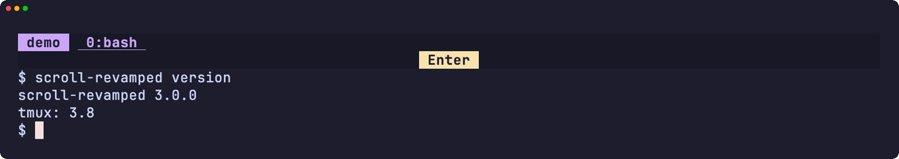<br><sub>バージョン。<code>stills.tape</code>より</sub></td>
<td width="50%" valign="top">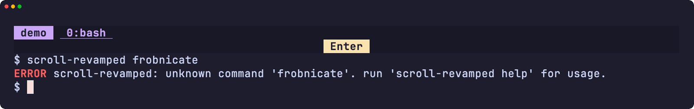<br><sub>不明なコマンド。<code>stills.tape</code>より</sub></td>
</tr>
<tr>
<td width="50%" valign="top">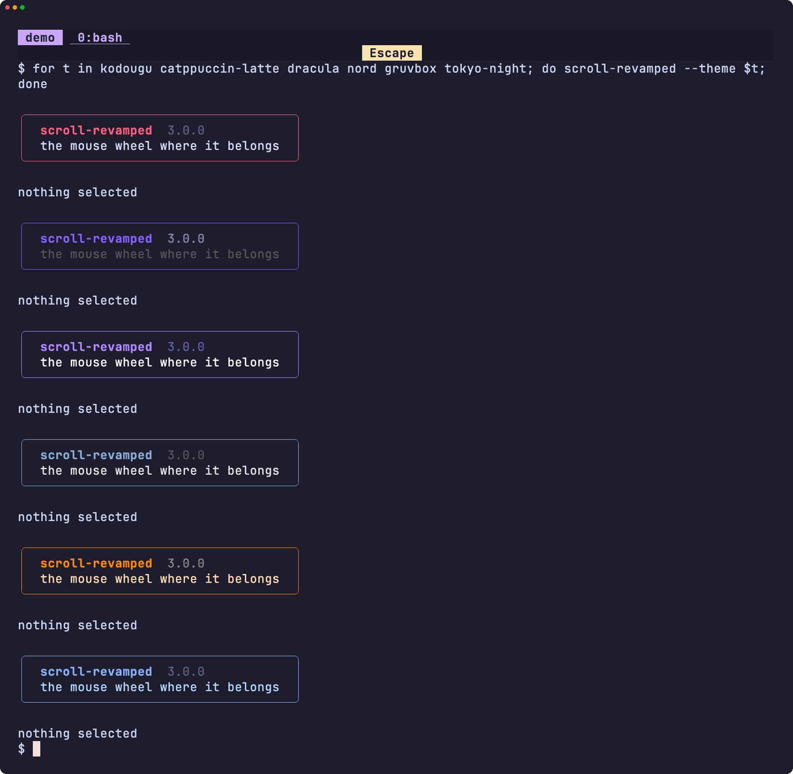<br><sub>6 つのテーマのヘッダー。<code>themes.tape</code>より</sub></td>
<td width="50%" valign="top">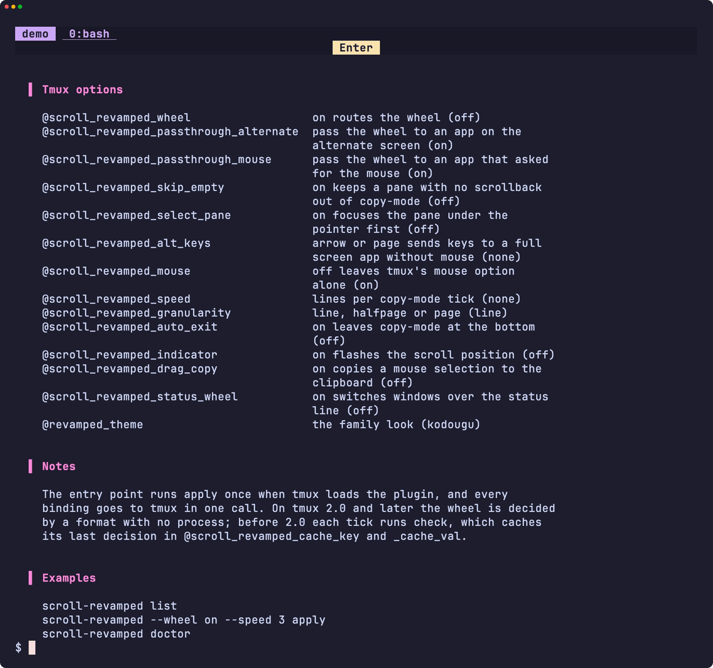<br><sub>ヘルプ。<code>help.tape</code>より</sub></td>
</tr>
<tr>
<td width="50%" valign="top">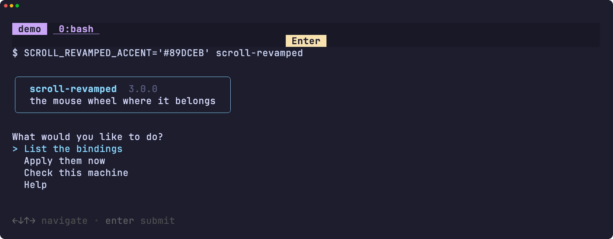<br><sub><code>SCROLL_REVAMPED_ACCENT</code> によるアクセント。<code>stills.tape</code>より</sub></td>
<td width="50%" valign="top"></td>
</tr>
</table>

</details>

## 移植性

プラグインは POSIX `sh` です。CI は下の各行ですべてのテストを実行します。

| シェル | 状態 |
|:------|:-------|
| `dash`、macOS の `/bin/sh` | 対応 |
| `bash` 3.2 と 5.x、システムの `zsh` と Homebrew の `zsh` | 対応 |

| システム | 状態 |
|:-------|:-------|
| macOS | Apple Silicon と Intel の Tahoe。付属のツール、Homebrew の GNU ツール、Homebrew の uutils で確認 |
| Linux | x86_64 と arm64 の Ubuntu 26.04。GNU coreutils、uutils、BusyBox で確認 |

## 開発

| コマンド | 実行内容 |
|:--------|:-------------|
| `make fmt` | すべてのスクリプトに shfmt `-i 2` をかけます |
| `make lint` | shfmt、ShellCheck、mandoc、yamllint、actionlint を、指摘ゼロで通します |
| `make test` | システムの `sh` で bats のテスト |
| `make test-all` | インストール済みのすべてのシェルでテスト。macOS では bash と zsh の両方のビルドを含みます |
| `make test-linux` | Ubuntu のコンテナでテスト |
| `make coverage` | この Mac と Ubuntu のコンテナで bashcov を実行し、合算して 100 パーセントで判定します |
| `make screens` | 上の画面を、本物のプラグインから tmux の中で VHS で録画します。macOS で実行します |
| `make install` | コマンド、manページ、補完を `PREFIX` の下に置きます |

コミットは Conventional Commits の形式に従い、そのまま `main` に入ります。`main` で `ci` が成功すると、`release.yml` が semantic-release を実行します。前回のタグ以降に `feat` か `fix` があればリリースを公開し、バージョン定数を更新し、変更内容を [`CHANGELOG.md`](CHANGELOG.md) に追加します。

## ライセンス

[MIT](LICENSE)、copyright Gustavo Franco。

<!-- family:begin -->

## tmux-revamped ファミリー

このプラグインは tmux-revamped ファミリーの一員です。すべてのメンバーが [`FAMILY.md`](FAMILY.md) の同じ規約と同じ共有ライブラリを持ちます。メンバーは一緒にインストールする前提で作られており、ほかのメンバーが使うキーや tmux オプションを使うメンバーはありません。

あるメンバーで見つかった不具合は、修正完了とする前に全メンバーで同じ不具合を探します。

| メンバー | 機能 |
|---|---|
| [`tmux-autoreload-revamped`](https://github.com/tmux-revamped/tmux-autoreload-revamped) | tmuxの設定を編集して保存するだけで、キーもコマンドも使わずに自動で再読み込みされます |
| [`tmux-battery-revamped`](https://github.com/tmux-revamped/tmux-battery-revamped) | tmuxのステータスバーに電池の状態を表示し、ステータスの描画を一切止めません |
| [`tmux-bluetooth-revamped`](https://github.com/tmux-revamped/tmux-bluetooth-revamped) | 接続中のすべてのBluetooth機器とその電池残量をtmuxのステータスバーに表示し、描画を止めません |
| [`tmux-cpu-revamped`](https://github.com/tmux-revamped/tmux-cpu-revamped) | CPUの負荷、温度、周波数をtmuxのステータスバーに表示し、描画を一切止めません |
| [`tmux-disk-revamped`](https://github.com/tmux-revamped/tmux-disk-revamped) | tmuxのステータスバーにディスク使用量を表示し、ステータスの描画を一切止めません |
| [`tmux-extract-revamped`](https://github.com/tmux-revamped/tmux-extract-revamped) | 画面上の URL、パス、ハッシュなどのトークンを fzf で選び、カーソル位置に入力します。純粋なシェルだけで動きます |
| [`tmux-fzf-revamped`](https://github.com/tmux-revamped/tmux-fzf-revamped) | ポップアップ内の fzf ピッカーから、tmux のセッション、ウィンドウ、ペインの切り替え、終了、名前変更、作成を行います |
| [`tmux-git-revamped`](https://github.com/tmux-revamped/tmux-git-revamped) | アクティブなペインのgitブランチ、変更、プロバイダーの件数を、描画を止めずにtmuxのステータスバーに表示します |
| [`tmux-gpu-revamped`](https://github.com/tmux-revamped/tmux-gpu-revamped) | NVIDIA、AMD、Intel、Apple の GPU の負荷、温度、クロック、電力、メモリを tmux のステータスバーに表示します |
| [`tmux-kube-revamped`](https://github.com/tmux-revamped/tmux-kube-revamped) | 現在の Kubernetes コンテキストと名前空間を、kubectl を使わずに kubeconfig から解析して tmux のステータスバーに表示します |
| [`tmux-launcher-revamped`](https://github.com/tmux-revamped/tmux-launcher-revamped) | 任意の TUI アプリを、現在のペインのディレクトリでポップアップまたはウィンドウとして起動します。アプリごとにキーを設定できます |
| [`tmux-logging-revamped`](https://github.com/tmux-revamped/tmux-logging-revamped) | 任意のペインをファイルに保存します。ライブのログ記録、スクロールバック全体、1 回限りのスクリーンショットに対応します |
| [`tmux-music-revamped`](https://github.com/tmux-revamped/tmux-music-revamped) | 再生中の曲をステータスバーに表示し、ステータスの描画を止めません |
| [`tmux-network-revamped`](https://github.com/tmux-revamped/tmux-network-revamped) | ネットワークのスループットをステータスバーに表示し、描画を止めません |
| [`tmux-pain-control-revamped`](https://github.com/tmux-revamped/tmux-pain-control-revamped) | tmux のペインとウィンドウの操作キー。tmux のバージョンに対応し、vim と共存でき、どの prefix キーも無効にできます |
| [`tmux-persist-revamped`](https://github.com/tmux-revamped/tmux-persist-revamped) | tmuxのすべてのセッション、ウィンドウ、ペインを保存し、タイマーで自動保存して、再起動後にすべて復元します |
| [`tmux-plugin-template`](https://github.com/tmux-revamped/tmux-plugin-template) | tmux-revampedプラグインの出発点です。共有ライブラリ、batsハーネス、CIを含みます |
| [`tmux-pomodoro-revamped`](https://github.com/tmux-revamped/tmux-pomodoro-revamped) | すべての状態をtmuxオプションに保持し、一時ファイルを使わない、tmuxステータスバーのポモドーロタイマーです |
| [`tmux-ram-revamped`](https://github.com/tmux-revamped/tmux-ram-revamped) | RAM、スワップ、メモリプレッシャーをtmuxのステータスバーに表示します。計測はバックグラウンドで行うため描画を待たせません |
| [`tmux-reorder-revamped`](https://github.com/tmux-revamped/tmux-reorder-revamped) | tmuxのステータスバー上でウィンドウのタブをマウスでドラッグして、そのウィンドウを移動します |
| [`tmux-scroll-revamped`](https://github.com/tmux-revamped/tmux-scroll-revamped) | **このプラグイン**、自分でスクロールできるアプリにはマウスホイールを渡し、それ以外ではtmuxのコピーモードに入ります |
| [`tmux-sensible-revamped`](https://github.com/tmux-revamped/tmux-sensible-revamped) | tmuxのバージョンと端末に合わせて適用され、ユーザーが設定したオプションには触れない、妥当な初期設定です |
| [`tmux-tiling-revamped`](https://github.com/tmux-revamped/tmux-tiling-revamped) | tmuxのタイル型ウィンドウ管理です。BSPのdwindleとspiralを含む8つのレイアウトと、レイアウトの取り消しがあります |
| [`tmux-time-revamped`](https://github.com/tmux-revamped/tmux-time-revamped) | ステータスバーにローカル時計と世界時計を時間帯ごとの色で表示し、カウントダウンと夏時間の警告も出します |
| [`tmux-weather-revamped`](https://github.com/tmux-revamped/tmux-weather-revamped) | wttr.inの天気をバックグラウンドで取得し、ステータスバーを待たせずに表示します |

<!-- family:end -->
