<div align="center">

# tmux-scroll-revamped

<strong>Send the mouse wheel to apps that scroll themselves and into tmux copy-mode everywhere else.</strong>

English &nbsp;|&nbsp; [日本語](README.ja.md) &nbsp;|&nbsp; [简体中文](README.zh-Hans.md) &nbsp;|&nbsp; [繁體中文（香港）](README.zh-HK.md)

[](https://github.com/tmux-revamped/tmux-scroll-revamped/actions/workflows/ci.yml)
[](https://github.com/tmux-revamped/tmux-scroll-revamped/releases/latest)
[](https://scorecard.dev/viewer/?uri=github.com/tmux-revamped/tmux-scroll-revamped)
[](LICENSE)

<p align="center">
  <a href="#quick-start"><strong>Quick start</strong></a> &nbsp;|&nbsp;
  <a href="#usage">Usage</a> &nbsp;|&nbsp;
  <a href="#how-it-decides">How it decides</a> &nbsp;|&nbsp;
  <a href="#screens">Screens</a>
</p>

</div>

<p align="center">
  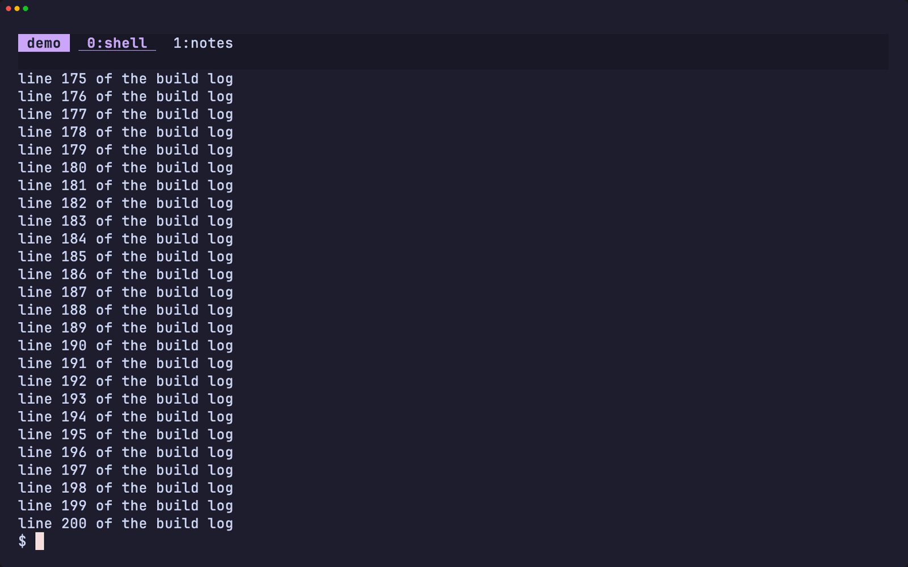
</p>

```console
$ scroll-revamped --wheel on list
set-option -g mouse on
bind-key -n WheelUpPane if-shell -F "#{?#{||:#{alternate_on},#{||:#{mouse_any_flag},#{pane_in_mode}}},1,0}" "send-keys -M" "copy-mode -e ; send-keys -X -N 5 scroll-up"
bind-key -n WheelDownPane send-keys -M
```

A full-screen app on the alternate screen, such as vim, less, htop or Claude Code, gets the wheel, and so does any app that asked for the mouse. Over a shell prompt the wheel enters copy-mode and scrolls the tmux history. The decision is a tmux format, so no app is named and no process starts per tick.

---

## Quick start

### Prerequisites

| Tool | Version | Used for |
|:-----|:--------|:---------|
| tmux | 3.2 or later | the family floor; the bindings also build on tmux 1.9 to 3.1, with the fallbacks under How it decides |
| clipboard tool | optional | `@scroll_revamped_drag_copy` and `@scroll_revamped_click_copy`: `pbcopy` on macOS, `wl-copy`, `xclip` or `xsel` on Linux |
| gum | optional | the menu, tables and colours of `scroll-revamped`; without it every command prints plain text |

### Install

```tmux
set -g @plugin 'tmux-revamped/tmux-scroll-revamped'
set -g @scroll_revamped_wheel 'on'
```

Then press `prefix + I`. Without TPM, clone the repository and run its entry point from `~/.tmux.conf`:

```bash
git clone https://github.com/tmux-revamped/tmux-scroll-revamped ~/.tmux/plugins/tmux-scroll-revamped
```

```tmux
run-shell ~/.tmux/plugins/tmux-scroll-revamped/scroll-revamped.tmux
```

`make install` in the clone also puts `scroll-revamped` in `~/.local/bin`, with its man page and completions under `~/.local/share`.

### Verify

```bash
~/.tmux/plugins/tmux-scroll-revamped/bin/scroll-revamped doctor
```

## Usage

With `@scroll_revamped_wheel` on, scroll: over vim, less, htop or a full-screen app the wheel scrolls the app, and over a shell prompt it scrolls the tmux history. The plugin also turns tmux's `mouse` option on; set `@scroll_revamped_mouse` to `off` to manage it yourself.

| Command | What it does |
|:--------|:-------------|
| `scroll-revamped apply` | Binds the wheel now; the entry point runs it when tmux loads the plugin |
| `scroll-revamped list` | Prints every binding apply would make; `--json` prints one object |
| `scroll-revamped check ALT MOUSE HISTORY PANE` | Decides one wheel tick on tmux before 2.0: exits 0 to pass it to the app, 1 to enter copy-mode |
| `scroll-revamped doctor` | One row per dependency, the clipboard tool included |
| `scroll-revamped version` | The version, then the tmux version |
| `scroll-revamped help` | The help page; `man scroll-revamped` documents the same commands and settings |
| `scroll-revamped` | On a terminal, a menu |

| tmux option | Default | Meaning |
|:------------|:--------|:--------|
| `@scroll_revamped_wheel` | `off` | `on` binds the root-table `WheelUpPane` and `WheelDownPane` that route the wheel; `off` leaves tmux's own wheel in place |
| `@scroll_revamped_passthrough_alternate` | `on` | Pass the wheel to an app on the alternate screen; `off` sends those panes into copy-mode |
| `@scroll_revamped_passthrough_mouse` | `on` | Pass the wheel to an app that asked for the mouse |
| `@scroll_revamped_skip_empty` | `off` | `on` keeps a pane with no history out of copy-mode |
| `@scroll_revamped_select_pane` | `off` | `on` focuses the pane under the pointer before scrolling |
| `@scroll_revamped_alt_keys` | none | `arrow` or `page` turns the wheel into arrow or page keys for an alternate-screen app with the mouse off, such as less, man or vi; arrow mode sends `@scroll_revamped_speed` keys per tick, 3 when unset, at most 20 |
| `@scroll_revamped_mouse` | `on` | `off` stops the plugin from setting tmux's `mouse` option |
| `@scroll_revamped_speed` | none | Lines one copy-mode tick scrolls, a positive whole number |
| `@scroll_revamped_granularity` | `line` | How far one copy-mode tick scrolls: `line`, `halfpage` or `page` |
| `@scroll_revamped_auto_exit` | `off` | `on` leaves copy-mode when a downward tick is already at the bottom |
| `@scroll_revamped_indicator` | `off` | `on` flashes the scroll position, such as `scroll 120/4000`, on each copy-mode tick |
| `@scroll_revamped_drag_copy` | `off` | `on` copies a mouse selection in copy-mode to the system clipboard |
| `@scroll_revamped_click_copy` | `off` | `on` copies the word under a double click and the line under a triple click to the system clipboard, and leaves copy-mode |
| `@scroll_revamped_smooth` | `off` | `on` scrolls a copy-mode tick in steps with a 5 ms pause between, one line per step up to 20 lines, so the text slides instead of jumping; line granularity and a speed below 1000, tmux 3.2 and later |
| `@scroll_revamped_status_wheel` | `off` | `on` switches windows when the wheel rolls over the status line |

Every option is also a command option with dashes, such as `--skip-empty on`, and an environment variable, such as `SCROLL_REVAMPED_SKIP_EMPTY`; the command line wins over the environment, and the environment over the tmux option. An empty tmux option means its default. With both passthrough options off, the wheel always enters copy-mode.

<a id="how-it-decides"></a>

## How it decides

`WheelUpPane` checks one condition: the pane is on the alternate screen, or its app asked for the mouse, or the pane is already in a mode. When it holds, the wheel event goes to the pane with `send-keys -M`; otherwise tmux enters copy-mode with `copy-mode -e`, which leaves again when you scroll back to the bottom. `WheelDownPane` always forwards the event, so it scrolls the app or the open copy-mode.

| tmux | Routing |
|:-----|:--------|
| 3.1 and later | One format with the `#{\|\|:}` and `#{&&:}` operators |
| 2.0 to 3.0 | The same condition built from nested `#{?}` |
| 1.9 | `scroll-revamped check` runs on each tick, and its answer is cached per pane state in `@scroll_revamped_cache_key` and `@scroll_revamped_cache_val` |

Speed, granularity, auto-exit and the indicator rebind the wheel in the `copy-mode` and `copy-mode-vi` tables on tmux 2.4 and later; the indicator needs tmux 3.2, and the status-line wheel needs tmux 2.1.

<a id="screens"></a>

## Screens

<details>
<summary>Every screen, recorded inside a real tmux with <code>make screens</code>, with each mouse gesture and key on the status line</summary>
<br>

<table>
<tr>
<td width="50%" valign="top">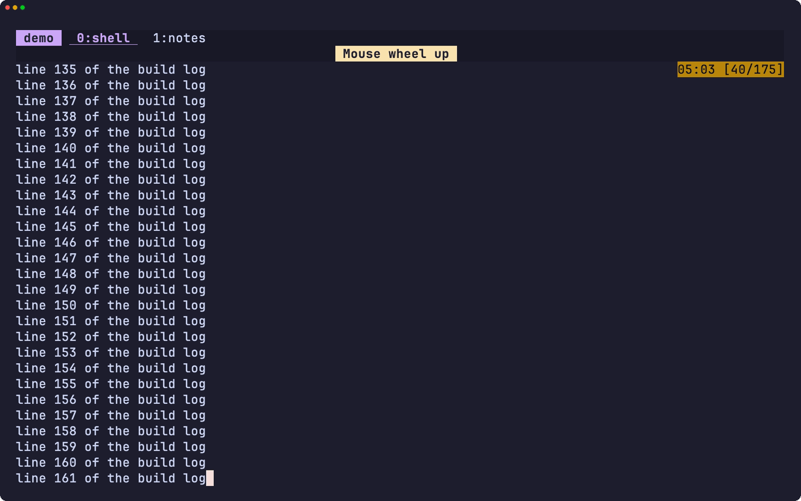<br><sub>The wheel over a shell enters copy-mode and scrolls the history, from <code>hero.tape</code></sub></td>
<td width="50%" valign="top">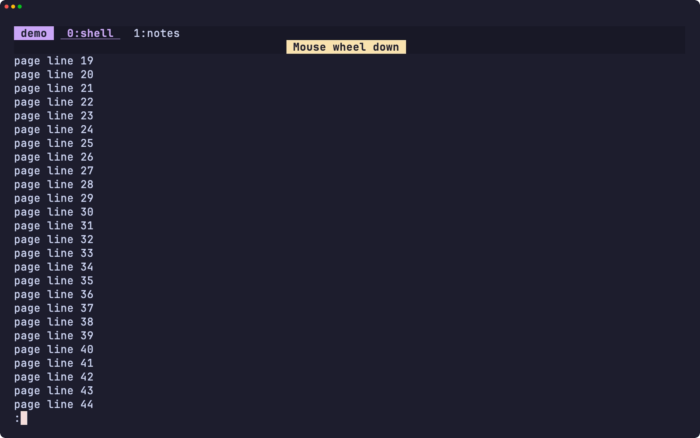<br><sub><code>@scroll_revamped_alt_keys arrow</code> scrolls less with arrow keys, from <code>hero.tape</code></sub></td>
</tr>
<tr>
<td width="50%" valign="top">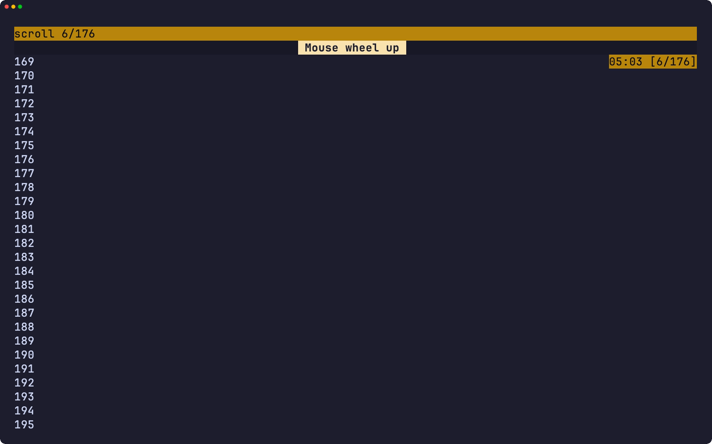<br><sub><code>@scroll_revamped_indicator</code> flashes the scroll position, from <code>hero.tape</code></sub></td>
<td width="50%" valign="top">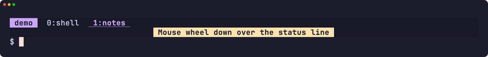<br><sub><code>@scroll_revamped_status_wheel</code> switches windows over the status line, from <code>hero.tape</code></sub></td>
</tr>
<tr>
<td width="50%" valign="top">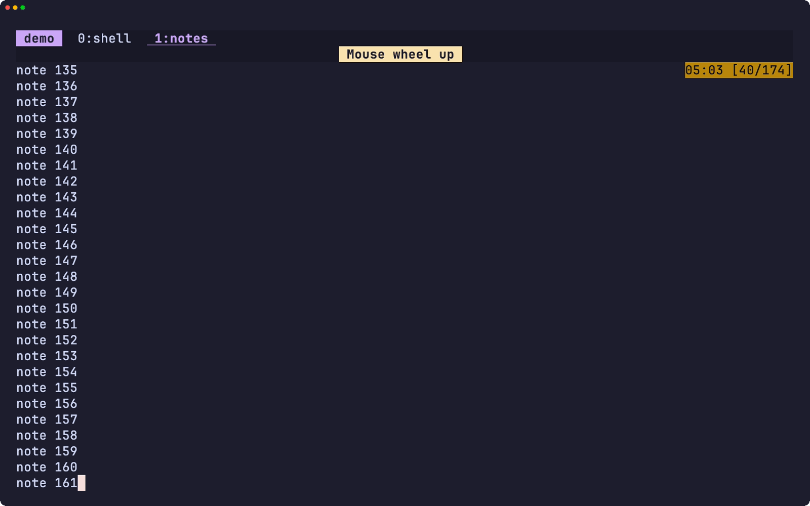<br><sub><code>@scroll_revamped_smooth</code> scrolls a wheel tick one line at a time, from <code>hero.tape</code></sub></td>
<td width="50%" valign="top">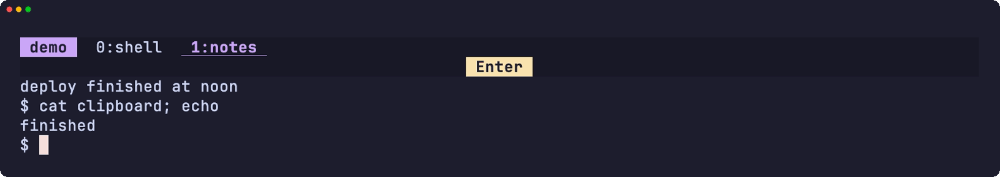<br><sub><code>@scroll_revamped_click_copy</code> copies a double-clicked word to the clipboard, from <code>hero.tape</code></sub></td>
</tr>
<tr>
<td width="50%" valign="top">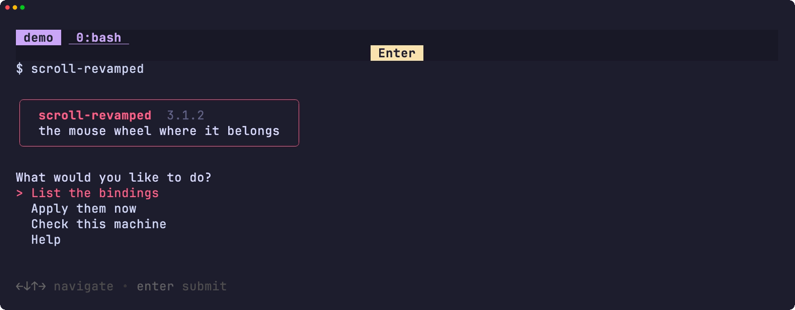<br><sub>The menu, from <code>stills.tape</code></sub></td>
<td width="50%" valign="top">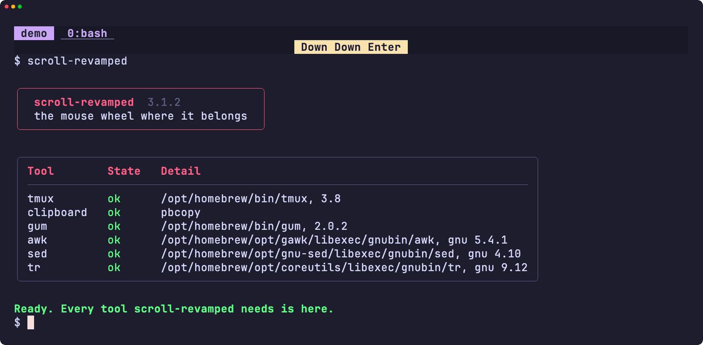<br><sub><code>doctor</code>, from <code>stills.tape</code></sub></td>
</tr>
<tr>
<td width="50%" valign="top">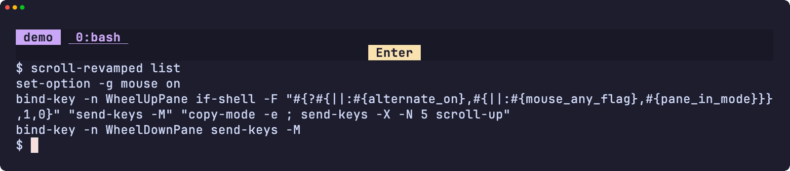<br><sub><code>list</code>, from <code>stills.tape</code></sub></td>
<td width="50%" valign="top">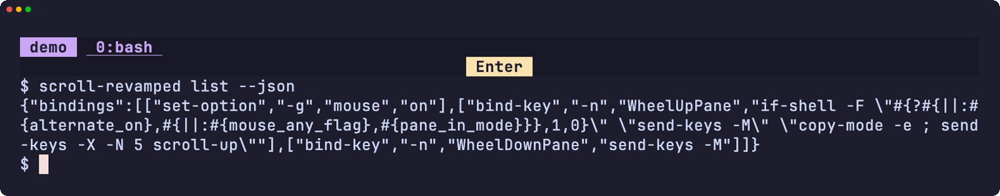<br><sub><code>list --json</code>, from <code>stills.tape</code></sub></td>
</tr>
<tr>
<td width="50%" valign="top">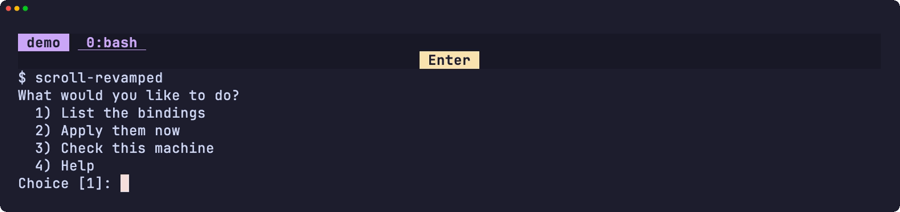<br><sub>The menu without gum, from <code>stills.tape</code></sub></td>
<td width="50%" valign="top">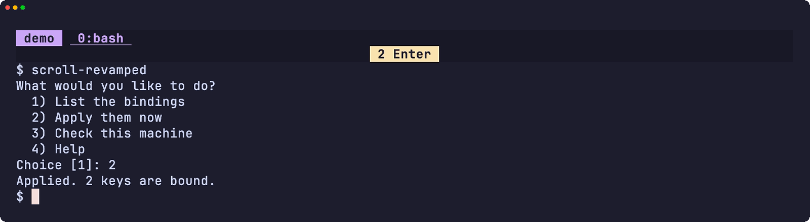<br><sub><code>apply</code> from the menu, from <code>stills.tape</code></sub></td>
</tr>
<tr>
<td width="50%" valign="top">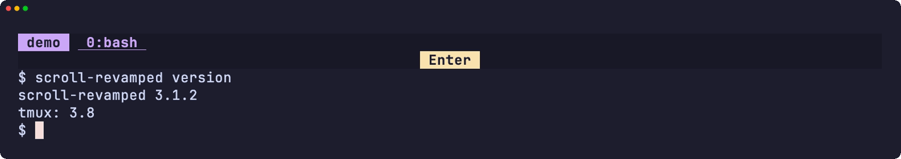<br><sub>The version, from <code>stills.tape</code></sub></td>
<td width="50%" valign="top">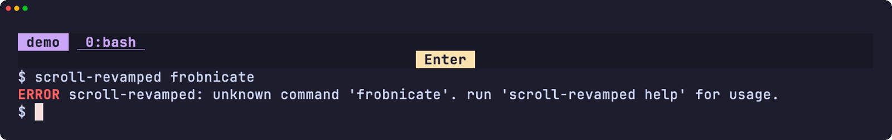<br><sub>An unknown command, from <code>stills.tape</code></sub></td>
</tr>
<tr>
<td width="50%" valign="top">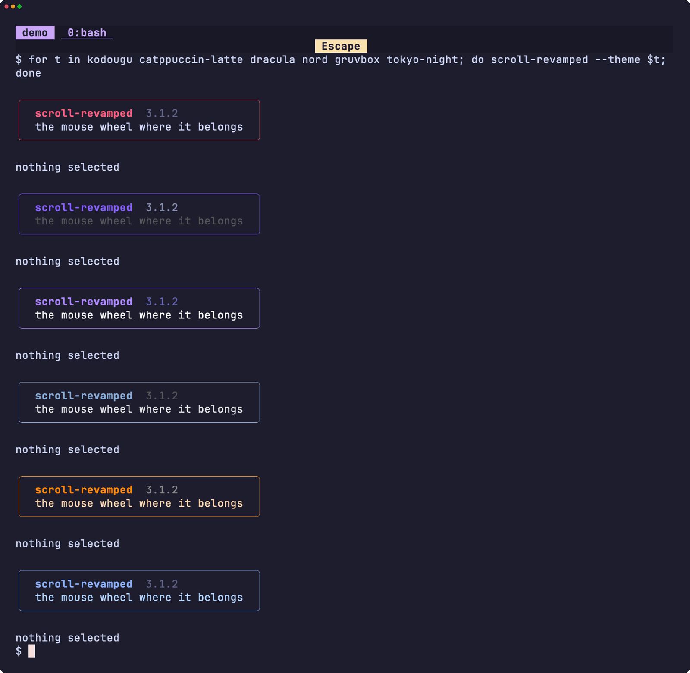<br><sub>The header in six themes, from <code>themes.tape</code></sub></td>
<td width="50%" valign="top">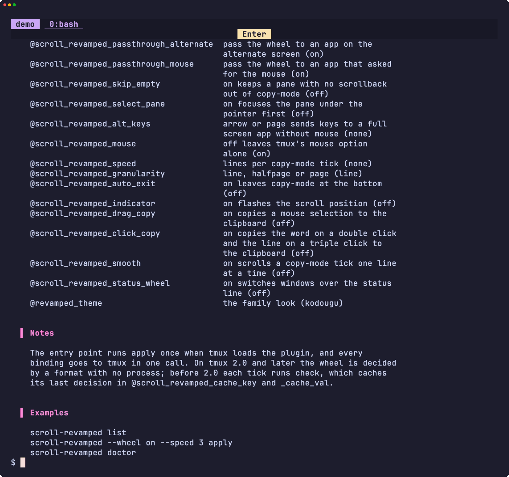<br><sub>The help page, from <code>help.tape</code></sub></td>
</tr>
<tr>
<td width="50%" valign="top">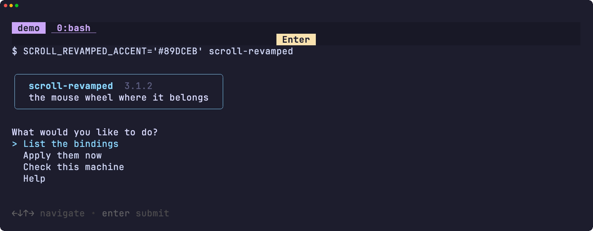<br><sub>An accent from <code>SCROLL_REVAMPED_ACCENT</code>, from <code>stills.tape</code></sub></td>
<td width="50%" valign="top"></td>
</tr>
</table>

</details>

## Portability

The plugin is POSIX `sh`. CI runs every suite on each row below.

| Shell | Status |
|:------|:-------|
| `dash`, `/bin/sh` on macOS | Supported |
| `bash` 3.2 and 5.x, the system's `zsh` and Homebrew's | Supported |

| System | Status |
|:-------|:-------|
| macOS | Tahoe on Apple Silicon and Intel, with the tools it ships, Homebrew's GNU tools and Homebrew's uutils |
| Linux | Ubuntu 26.04 on x86_64 and arm64, with GNU coreutils, uutils and BusyBox |

## Development

| Command | What it runs |
|:--------|:-------------|
| `make fmt` | shfmt `-i 2` on every script |
| `make lint` | shfmt, ShellCheck, mandoc, yamllint and actionlint, at zero findings |
| `make test` | The bats suites under the system `sh` |
| `make test-all` | The suites under every installed shell, both builds of bash and zsh on macOS |
| `make test-linux` | The suites in an Ubuntu container |
| `make coverage` | bashcov on this Mac and in the Ubuntu container, merged and gated at 100 percent |
| `make screens` | The screens above, recorded from the real plugin inside tmux with VHS, on macOS |
| `make install` | The command, its man page and completions under `PREFIX` |

Commits follow the conventional commit format and go straight to `main`. After a green `ci` run on `main`, `release.yml` runs semantic-release: every `feat` or `fix` since the last tag publishes a release, stamps the version constant and adds the notes to [`CHANGELOG.md`](CHANGELOG.md).

## License

[MIT](LICENSE), copyright Gustavo Franco.

<!-- family:begin -->

## The tmux-revamped family

This plugin is one member of the tmux-revamped family. Every member carries the same contract in [`FAMILY.md`](FAMILY.md) and the same shared library, and they are built to be installed together: no member claims a key or a tmux option that another member claims.

A defect found in one member is hunted across all of them before the fix is called done.

| Member | What it does |
|---|---|
| [`tmux-autoreload-revamped`](https://github.com/tmux-revamped/tmux-autoreload-revamped) | Edit your tmux config, save, and watch it reload itself, no key, no command |
| [`tmux-battery-revamped`](https://github.com/tmux-revamped/tmux-battery-revamped) | Battery status for your tmux status bar, without ever blocking the status render |
| [`tmux-bluetooth-revamped`](https://github.com/tmux-revamped/tmux-bluetooth-revamped) | Every connected Bluetooth device and its battery in your tmux status bar, without blocking the render |
| [`tmux-cpu-revamped`](https://github.com/tmux-revamped/tmux-cpu-revamped) | CPU load, temperature, and frequency in your tmux status bar, without ever blocking the render |
| [`tmux-disk-revamped`](https://github.com/tmux-revamped/tmux-disk-revamped) | Disk usage for your tmux status bar, without ever blocking the status render |
| [`tmux-extract-revamped`](https://github.com/tmux-revamped/tmux-extract-revamped) | Pick a URL, path, hash or any other token off the screen with fzf and type it at the cursor, in pure shell |
| [`tmux-fzf-revamped`](https://github.com/tmux-revamped/tmux-fzf-revamped) | Switch to, kill, rename or create tmux sessions, windows and panes from fzf pickers in a popup |
| [`tmux-git-revamped`](https://github.com/tmux-revamped/tmux-git-revamped) | Show the active pane's git branch, changes and provider counts in the tmux status bar without blocking it |
| [`tmux-gpu-revamped`](https://github.com/tmux-revamped/tmux-gpu-revamped) | GPU load, temperature, clock, power and memory in the tmux status bar, from NVIDIA, AMD, Intel and Apple GPUs |
| [`tmux-kube-revamped`](https://github.com/tmux-revamped/tmux-kube-revamped) | Current Kubernetes context and namespace in the tmux status bar, parsed from kubeconfig without kubectl |
| [`tmux-launcher-revamped`](https://github.com/tmux-revamped/tmux-launcher-revamped) | Open any terminal app in a tmux popup, window or split from one menu, starting at the project root |
| [`tmux-logging-revamped`](https://github.com/tmux-revamped/tmux-logging-revamped) | Capture any pane to a file: live logging, full scrollback, or a one-shot screenshot |
| [`tmux-music-revamped`](https://github.com/tmux-revamped/tmux-music-revamped) | Now playing in your tmux status bar, without ever blocking the status render |
| [`tmux-network-revamped`](https://github.com/tmux-revamped/tmux-network-revamped) | Network throughput in your tmux status bar, without ever blocking the render |
| [`tmux-pain-control-revamped`](https://github.com/tmux-revamped/tmux-pain-control-revamped) | Pane and window management bindings for tmux, version aware, vim friendly, every prefix key can be disabled |
| [`tmux-persist-revamped`](https://github.com/tmux-revamped/tmux-persist-revamped) | Save every tmux session, window and pane, auto-save on a timer, and restore it all after a reboot |
| [`tmux-plugin-template`](https://github.com/tmux-revamped/tmux-plugin-template) | The starting point for a tmux-revamped plugin: shared library, bats harness and CI |
| [`tmux-pomodoro-revamped`](https://github.com/tmux-revamped/tmux-pomodoro-revamped) | A Pomodoro timer in the tmux status bar that keeps all of its state in tmux options, with no temp files |
| [`tmux-ram-revamped`](https://github.com/tmux-revamped/tmux-ram-revamped) | RAM, swap and memory pressure in the tmux status bar, sampled in the background so the render never waits |
| [`tmux-reorder-revamped`](https://github.com/tmux-revamped/tmux-reorder-revamped) | Drag a window tab along the tmux status bar with the mouse to move that window |
| [`tmux-scroll-revamped`](https://github.com/tmux-revamped/tmux-scroll-revamped) | **this plugin**, Send the mouse wheel to apps that scroll themselves and into tmux copy-mode everywhere else |
| [`tmux-sensible-revamped`](https://github.com/tmux-revamped/tmux-sensible-revamped) | Sensible tmux defaults, gated by tmux version and terminal, that leave the options you set alone |
| [`tmux-tiling-revamped`](https://github.com/tmux-revamped/tmux-tiling-revamped) | Tiling window management for tmux: eight layouts including BSP dwindle and spiral, with layout undo |
| [`tmux-time-revamped`](https://github.com/tmux-revamped/tmux-time-revamped) | Local and world clocks for the tmux status bar, colored by time of day, with countdowns and a DST warning |
| [`tmux-weather-revamped`](https://github.com/tmux-revamped/tmux-weather-revamped) | Weather for the tmux status bar from wttr.in, fetched in the background so the status line never waits |

<!-- family:end -->
