<div align="center">

# tmux-scroll-revamped

<strong>把滑鼠滾輪交給會自己捲動的應用程式，其他情況進入 tmux 複製模式。</strong>

[English](README.md) &nbsp;|&nbsp; [日本語](README.ja.md) &nbsp;|&nbsp; [简体中文](README.zh-Hans.md) &nbsp;|&nbsp; 繁體中文（香港）

[](https://github.com/tmux-revamped/tmux-scroll-revamped/actions/workflows/ci.yml)
[](https://github.com/tmux-revamped/tmux-scroll-revamped/releases/latest)
[](https://scorecard.dev/viewer/?uri=github.com/tmux-revamped/tmux-scroll-revamped)
[](LICENSE)

<p align="center">
  <a href="#快速開始"><strong>快速開始</strong></a> &nbsp;|&nbsp;
  <a href="#用法">用法</a> &nbsp;|&nbsp;
  <a href="#判斷方式">判斷方式</a> &nbsp;|&nbsp;
  <a href="#畫面">畫面</a>
</p>

</div>

<p align="center">
  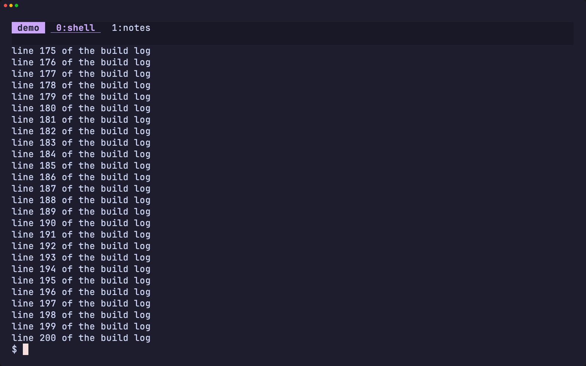
</p>

```console
$ scroll-revamped --wheel on list
set-option -g mouse on
bind-key -n WheelUpPane if-shell -F "#{?#{||:#{alternate_on},#{||:#{mouse_any_flag},#{pane_in_mode}}},1,0}" "send-keys -M" "copy-mode -e ; send-keys -X -N 5 scroll-up"
bind-key -n WheelDownPane send-keys -M
```

vim、less、htop 或 Claude Code 等在後備畫面上執行的全螢幕應用程式會收到滾輪，要求使用滑鼠的應用程式亦會收到。在 shell 提示字元上，滾輪進入複製模式並捲動 tmux 記錄。判斷由 tmux 格式完成，因此不用列出應用程式名稱，每次捲動亦不會啟動程序。

---

## 快速開始

### 前提條件

| 工具 | 版本 | 用途 |
|:-----|:--------|:---------|
| tmux | 3.2 或以上 | 系列的最低版本；在 tmux 1.9 至 3.1 上亦能用判斷方式中的後備方案建立綁定 |
| 剪貼簿工具 | 可選 | 用於 `@scroll_revamped_drag_copy` 和 `@scroll_revamped_click_copy`：macOS 上的 `pbcopy`，Linux 上的 `wl-copy`、`xclip` 或 `xsel` |
| gum | 可選 | `scroll-revamped` 的選單、表格和顏色；沒有它，所有命令都輸出純文字 |

### 安裝

```tmux
set -g @plugin 'tmux-revamped/tmux-scroll-revamped'
set -g @scroll_revamped_wheel 'on'
```

然後按 `prefix + I`。不使用 TPM 時，複製儲存庫，並在 `~/.tmux.conf` 中執行它的入口腳本：

```bash
git clone https://github.com/tmux-revamped/tmux-scroll-revamped ~/.tmux/plugins/tmux-scroll-revamped
```

```tmux
run-shell ~/.tmux/plugins/tmux-scroll-revamped/scroll-revamped.tmux
```

在複製的目錄中執行 `make install`，亦會把 `scroll-revamped` 放入 `~/.local/bin`，並把它的 man 手冊和自動完成放在 `~/.local/share` 下。

### 驗證

```bash
~/.tmux/plugins/tmux-scroll-revamped/bin/scroll-revamped doctor
```

## 用法

開啟 `@scroll_revamped_wheel` 後直接捲動：在 vim、less、htop 等全螢幕應用程式上捲動的是應用程式，在 shell 提示字元上捲動的是 tmux 記錄。插件亦會開啟 tmux 的 `mouse` 選項；想自己管理時把 `@scroll_revamped_mouse` 設為 `off`。

| 命令 | 作用 |
|:--------|:-------------|
| `scroll-revamped apply` | 立即綁定滾輪；插件載入時入口點會執行它 |
| `scroll-revamped list` | 列出 apply 會做的每個綁定；`--json` 輸出一個物件 |
| `scroll-revamped check ALT MOUSE HISTORY PANE` | 在 tmux 2.0 之前判斷一次捲動：交給應用程式時以 0 結束，進入複製模式時以 1 結束 |
| `scroll-revamped doctor` | 每個依賴一行，包括剪貼簿工具 |
| `scroll-revamped version` | 版本，然後是 tmux 版本 |
| `scroll-revamped help` | 說明頁；`man scroll-revamped` 記錄相同的命令和設定 |
| `scroll-revamped` | 在終端機上顯示選單 |

| tmux 選項 | 預設值 | 含義 |
|:------------|:--------|:--------|
| `@scroll_revamped_wheel` | `off` | `on` 綁定負責分配滾輪的根表 `WheelUpPane` 和 `WheelDownPane`；`off` 保留 tmux 自己的滾輪 |
| `@scroll_revamped_passthrough_alternate` | `on` | 把滾輪交給後備畫面上的應用程式；`off` 時這些窗格亦進入複製模式 |
| `@scroll_revamped_passthrough_mouse` | `on` | 把滾輪交給要求使用滑鼠的應用程式 |
| `@scroll_revamped_skip_empty` | `off` | `on` 時沒有記錄的窗格不進入複製模式 |
| `@scroll_revamped_select_pane` | `off` | `on` 時捲動前先選取指標下的窗格 |
| `@scroll_revamped_alt_keys` | 無 | `arrow` 或 `page` 把滾輪變成方向鍵或翻頁鍵，交給關閉了滑鼠的後備畫面應用程式，例如 less、man 或 vi；方向鍵模式每次發送 `@scroll_revamped_speed` 個鍵，未設定時為 3，最多 20 |
| `@scroll_revamped_mouse` | `on` | `off` 時插件不設定 tmux 的 `mouse` 選項 |
| `@scroll_revamped_speed` | 無 | 複製模式中每次捲動的行數，為正整數 |
| `@scroll_revamped_granularity` | `line` | 複製模式中每次捲動的幅度：`line`、`halfpage` 或 `page` |
| `@scroll_revamped_auto_exit` | `off` | `on` 時在底部向下捲動會離開複製模式 |
| `@scroll_revamped_indicator` | `off` | `on` 時每次複製模式捲動都閃示位置，例如 `scroll 120/4000` |
| `@scroll_revamped_drag_copy` | `off` | `on` 時把複製模式中的滑鼠選取範圍複製到系統剪貼簿 |
| `@scroll_revamped_click_copy` | `off` | `on` 時把雙擊的單詞和三擊的整行複製到系統剪貼簿，並退出複製模式 |
| `@scroll_revamped_smooth` | `off` | `on` 時把複製模式中的一格捲動拆成多步，每步相隔 5 毫秒，20 行以內每步一行，文字平滑移動而不跳動；只限按行捲動且速度低於 1000，需要 tmux 3.2 或以上 |
| `@scroll_revamped_status_wheel` | `off` | `on` 時在狀態列上轉動滾輪會切換視窗 |

每個選項亦可寫成以短橫線連接的命令選項，例如 `--skip-empty on`，以及環境變數，例如 `SCROLL_REVAMPED_SKIP_EMPTY`；命令列優先於環境變數，環境變數優先於 tmux 選項。空的 tmux 選項表示使用預設值。`doctor` 會指出數值無法識別的設定。兩個 passthrough 選項都為 `off` 時，滾輪總是進入複製模式。

<a id="判斷方式"></a>

## 判斷方式

`WheelUpPane` 只檢查一個條件：窗格在後備畫面上，或其應用程式要求使用滑鼠，或窗格已處於某種模式。條件成立時，滾輪事件用 `send-keys -M` 交給窗格；否則 tmux 用 `copy-mode -e` 進入複製模式，捲回底部時會自動離開。`WheelDownPane` 總是轉發事件，因此捲動的是應用程式或已開啟的複製模式。

| tmux | 分配方式 |
|:-----|:--------|
| 3.1 或以後 | 使用 `#{\|\|:}` 和 `#{&&:}` 運算子的單一格式 |
| 2.0 至 3.0 | 用巢狀的 `#{?}` 組成同一個條件 |
| 1.9 | 每次捲動都執行 `scroll-revamped check`，並按窗格狀態把結果快取在 `@scroll_revamped_cache_key` 和 `@scroll_revamped_cache_val` 中 |

速度、幅度、自動離開和位置提示在 tmux 2.4 或以後重新綁定 `copy-mode` 和 `copy-mode-vi` 表中的滾輪；位置提示需要 tmux 3.2，狀態列滾輪需要 tmux 2.1。

<a id="畫面"></a>

## 畫面

<details>
<summary>所有畫面，在真實的 tmux 中用 <code>make screens</code> 錄製，每個滑鼠手勢和按鍵顯示在狀態列上</summary>
<br>

<table>
<tr>
<td width="50%" valign="top">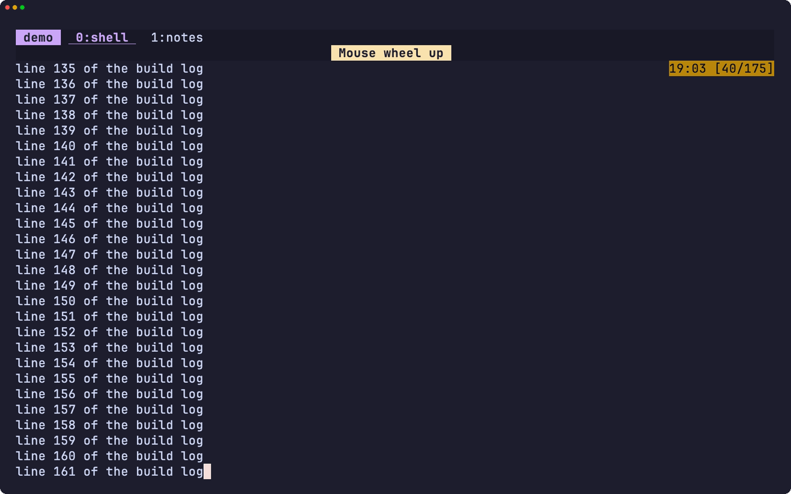<br><sub>在 shell 上轉動滾輪會進入複製模式並捲動記錄，來自 <code>hero.tape</code></sub></td>
<td width="50%" valign="top">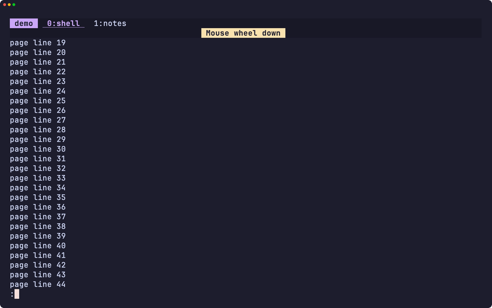<br><sub><code>@scroll_revamped_alt_keys arrow</code> 讓 less 用方向鍵捲動，來自 <code>hero.tape</code></sub></td>
</tr>
<tr>
<td width="50%" valign="top">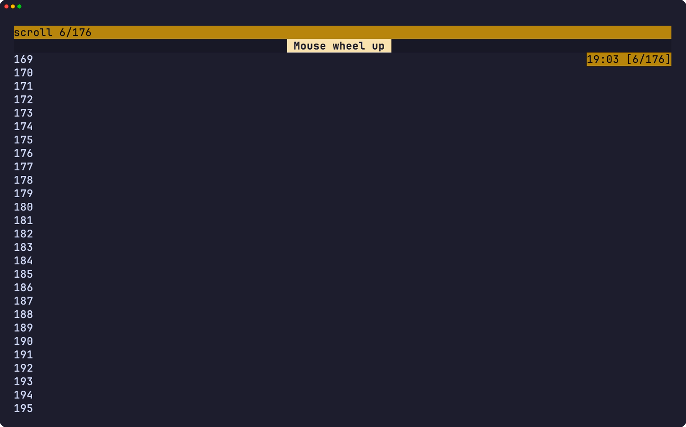<br><sub><code>@scroll_revamped_indicator</code> 閃示捲動位置，來自 <code>hero.tape</code></sub></td>
<td width="50%" valign="top">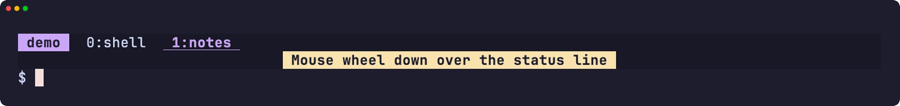<br><sub><code>@scroll_revamped_status_wheel</code> 讓狀態列上的滾輪切換視窗，來自 <code>hero.tape</code></sub></td>
</tr>
<tr>
<td width="50%" valign="top">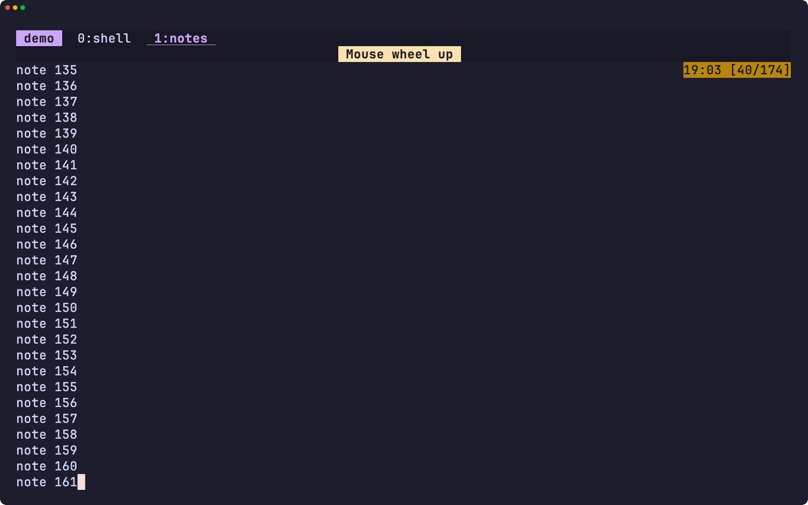<br><sub><code>@scroll_revamped_smooth</code> 把滾輪的一格拆成逐行捲動，來自 <code>hero.tape</code></sub></td>
<td width="50%" valign="top">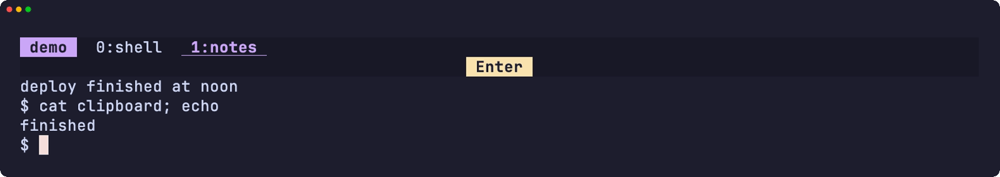<br><sub><code>@scroll_revamped_click_copy</code> 把雙擊的單詞複製到剪貼簿，來自 <code>hero.tape</code></sub></td>
</tr>
<tr>
<td width="50%" valign="top">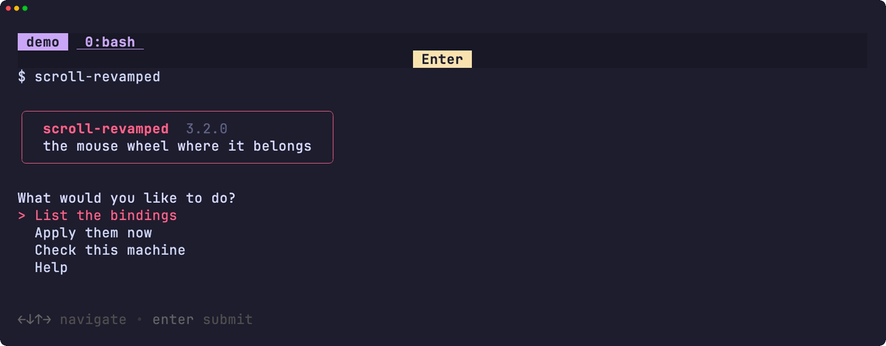<br><sub>選單，來自 <code>stills.tape</code></sub></td>
<td width="50%" valign="top">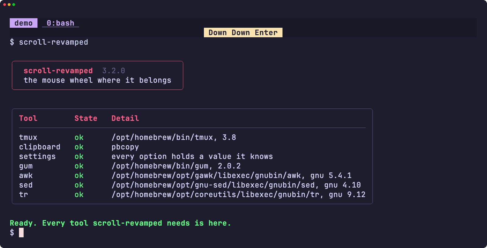<br><sub><code>doctor</code>，來自 <code>stills.tape</code></sub></td>
</tr>
<tr>
<td width="50%" valign="top">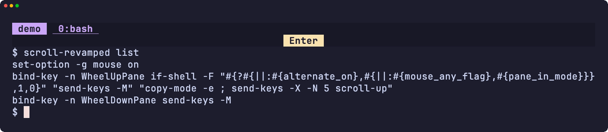<br><sub><code>list</code>，來自 <code>stills.tape</code></sub></td>
<td width="50%" valign="top">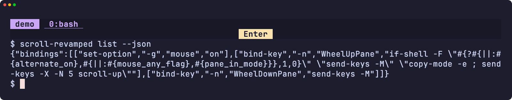<br><sub><code>list --json</code>，來自 <code>stills.tape</code></sub></td>
</tr>
<tr>
<td width="50%" valign="top">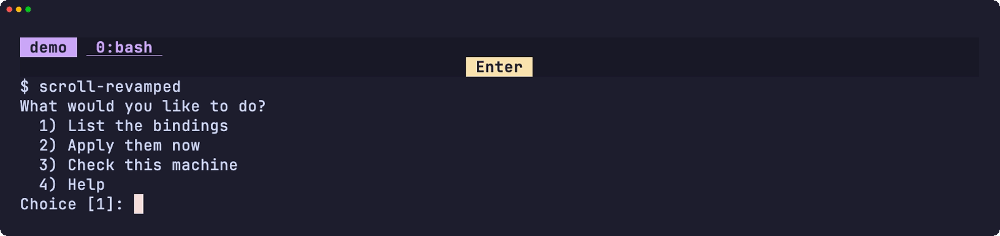<br><sub>沒有 gum 的選單，來自 <code>stills.tape</code></sub></td>
<td width="50%" valign="top">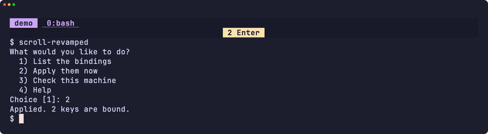<br><sub>從選單執行 <code>apply</code>，來自 <code>stills.tape</code></sub></td>
</tr>
<tr>
<td width="50%" valign="top">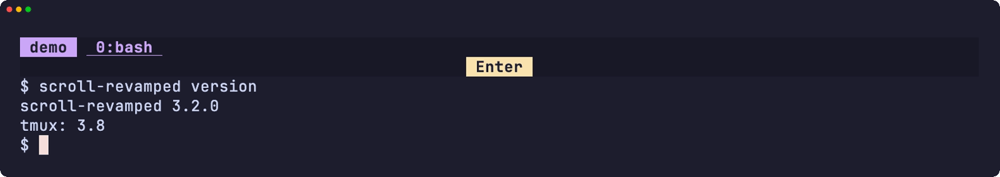<br><sub>版本，來自 <code>stills.tape</code></sub></td>
<td width="50%" valign="top">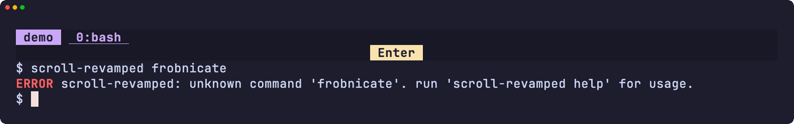<br><sub>不明命令，來自 <code>stills.tape</code></sub></td>
</tr>
<tr>
<td width="50%" valign="top">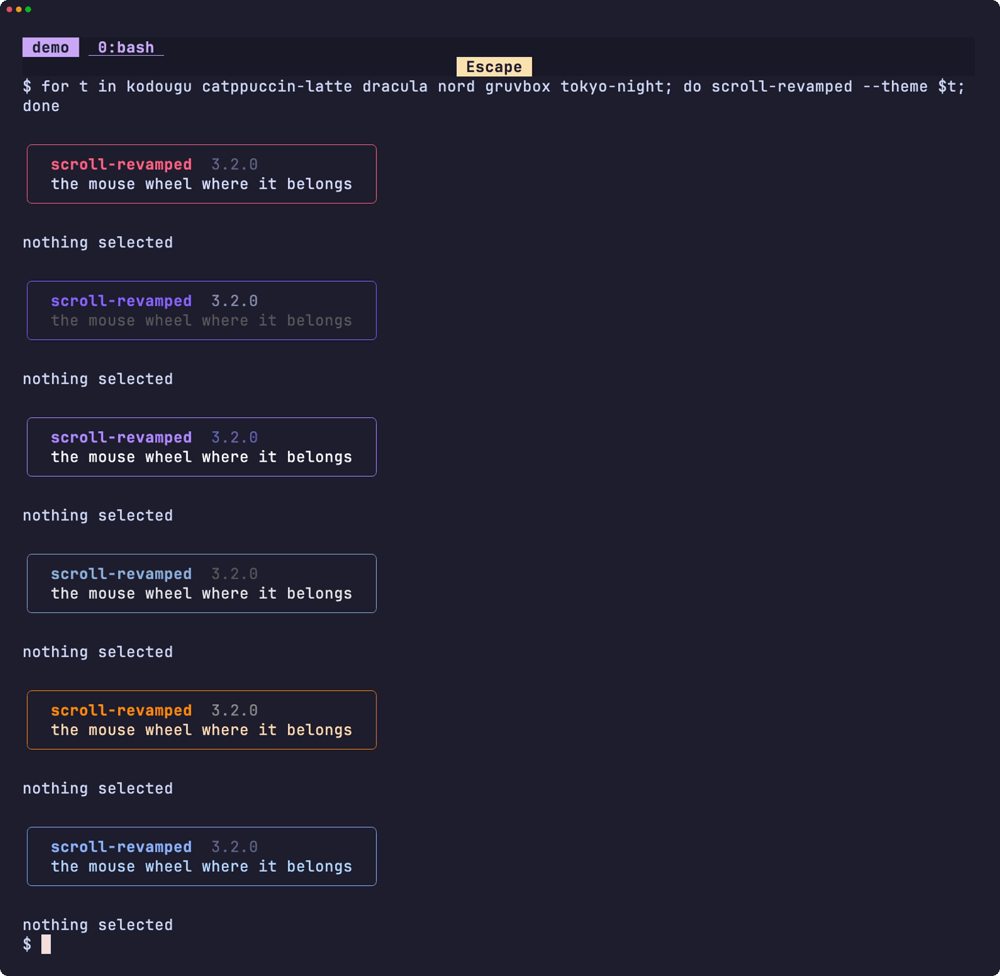<br><sub>六種主題下的標題，來自 <code>themes.tape</code></sub></td>
<td width="50%" valign="top">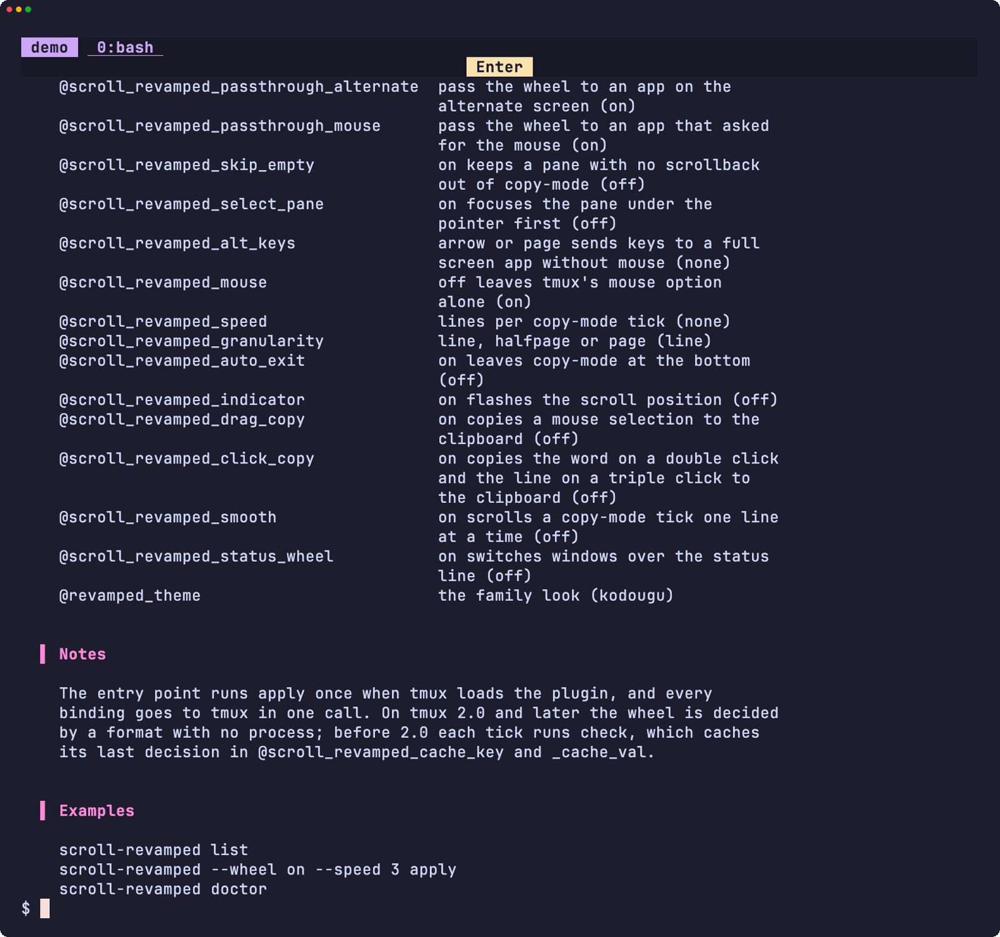<br><sub>說明頁，來自 <code>help.tape</code></sub></td>
</tr>
<tr>
<td width="50%" valign="top">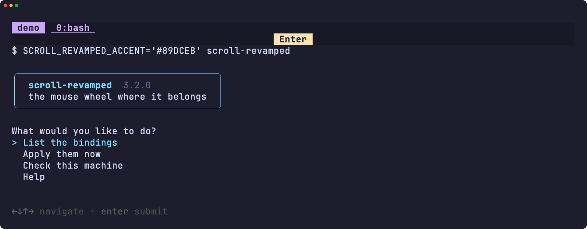<br><sub>來自 <code>SCROLL_REVAMPED_ACCENT</code> 的強調色，來自 <code>stills.tape</code></sub></td>
<td width="50%" valign="top"></td>
</tr>
</table>

</details>

## 可攜性

插件是 POSIX `sh`。CI 在下列每一行上執行全部測試。

| Shell | 狀態 |
|:------|:-------|
| `dash`、macOS 上的 `/bin/sh` | 支援 |
| `bash` 3.2 和 5.x、系統內建的 `zsh` 和 Homebrew 的 `zsh` | 支援 |

| 系統 | 狀態 |
|:-------|:-------|
| macOS | Apple Silicon 和 Intel 上的 Tahoe，使用內建的工具、Homebrew 的 GNU 工具和 Homebrew 的 uutils |
| Linux | x86_64 和 arm64 上的 Ubuntu 26.04，使用 GNU coreutils、uutils 和 BusyBox |

## 開發

| 指令 | 執行內容 |
|:--------|:-------------|
| `make fmt` | 對每個腳本執行 shfmt `-i 2` |
| `make lint` | shfmt、ShellCheck、mandoc、yamllint 和 actionlint，零警告 |
| `make test` | 在系統 `sh` 下執行 bats 測試 |
| `make test-all` | 在每個已安裝的 shell 下執行測試，macOS 上包括 bash 和 zsh 的兩種版本 |
| `make test-linux` | 在 Ubuntu 容器中執行測試 |
| `make coverage` | 在這部 Mac 和 Ubuntu 容器中執行 bashcov，合併後以 100% 為門檻 |
| `make screens` | 以 VHS 在 tmux 中從真實插件錄製上述畫面，在 macOS 上執行 |
| `make install` | 把指令、man 手冊和自動完成安裝到 `PREFIX` 下 |

在 macOS 上，執行 `brew bundle` 會根據 [`Brewfile`](Brewfile) 安裝這些目標用到的所有工具。

提交遵循 Conventional Commits 格式，直接進入 `main`。`main` 上的 `ci` 通過後，`release.yml` 會執行 semantic-release：自上一個標籤以來的每個 `feat` 或 `fix` 都會發佈新版本，更新版本常數，並把說明寫入 [`CHANGELOG.md`](CHANGELOG.md)。

## 授權

[MIT](LICENSE)，copyright Gustavo Franco。

<!-- family:begin -->

## tmux-revamped 插件家族

這個插件是 tmux-revamped 插件家族的一員。每個成員都帶有 [`FAMILY.md`](FAMILY.md) 中相同的約定和相同的共用程式庫，並且設計為一起安裝：沒有成員佔用另一個成員佔用的按鍵或 tmux 選項。

在一個成員中發現的缺陷，要在全部成員中排查後才算修正完成。

| 成員 | 功能 |
|---|---|
| [`tmux-autoreload-revamped`](https://github.com/tmux-revamped/tmux-autoreload-revamped) | 編輯並儲存 tmux 設定後，它會自動重新載入，毋須按鍵，也毋須指令 |
| [`tmux-battery-revamped`](https://github.com/tmux-revamped/tmux-battery-revamped) | 在 tmux 狀態列顯示電池狀態，從不阻塞狀態列繪製 |
| [`tmux-bluetooth-revamped`](https://github.com/tmux-revamped/tmux-bluetooth-revamped) | 在 tmux 狀態列顯示每部已連接的藍牙裝置及其電量，不阻塞繪製 |
| [`tmux-cpu-revamped`](https://github.com/tmux-revamped/tmux-cpu-revamped) | 在 tmux 狀態列顯示 CPU 負載、溫度及頻率，從不阻塞繪製 |
| [`tmux-disk-revamped`](https://github.com/tmux-revamped/tmux-disk-revamped) | 在 tmux 狀態列顯示磁碟用量，從不阻塞狀態列繪製 |
| [`tmux-extract-revamped`](https://github.com/tmux-revamped/tmux-extract-revamped) | 用 fzf 從畫面上揀選 URL、路徑、雜湊值或任何其他字詞，並輸入到游標位置，全部以純 shell 實現 |
| [`tmux-fzf-revamped`](https://github.com/tmux-revamped/tmux-fzf-revamped) | 在彈出視窗的 fzf 選擇器中切換、關閉、重新命名或建立 tmux 工作階段、視窗和窗格 |
| [`tmux-git-revamped`](https://github.com/tmux-revamped/tmux-git-revamped) | 在 tmux 狀態列顯示當前窗格的 git 分支、改動和託管平台數目，而不會阻塞顯示 |
| [`tmux-gpu-revamped`](https://github.com/tmux-revamped/tmux-gpu-revamped) | 在 tmux 狀態列顯示 NVIDIA、AMD、Intel 及 Apple GPU 的負載、溫度、時脈、功耗及記憶體 |
| [`tmux-kube-revamped`](https://github.com/tmux-revamped/tmux-kube-revamped) | 在 tmux 狀態列顯示目前的 Kubernetes 上下文及命名空間，毋須 kubectl，直接解析 kubeconfig |
| [`tmux-launcher-revamped`](https://github.com/tmux-revamped/tmux-launcher-revamped) | 在彈出視窗或新視窗中啟動任何 TUI 應用程式，從目前窗格的目錄開始，每個應用程式可設定一個按鍵 |
| [`tmux-logging-revamped`](https://github.com/tmux-revamped/tmux-logging-revamped) | 將任何窗格儲存到檔案：即時記錄、完整捲動緩衝區或一次性截圖 |
| [`tmux-music-revamped`](https://github.com/tmux-revamped/tmux-music-revamped) | 在 tmux 狀態列顯示正在播放的歌曲，從不阻塞狀態列的繪製 |
| [`tmux-network-revamped`](https://github.com/tmux-revamped/tmux-network-revamped) | 在 tmux 狀態列顯示網絡傳輸量，從不阻塞繪製 |
| [`tmux-pain-control-revamped`](https://github.com/tmux-revamped/tmux-pain-control-revamped) | tmux 的窗格和視窗管理按鍵，配合 tmux 版本，與 vim 相容，每個 prefix 按鍵都可停用 |
| [`tmux-persist-revamped`](https://github.com/tmux-revamped/tmux-persist-revamped) | 儲存 tmux 的所有工作階段、視窗及窗格，按計時器自動儲存，並在重新開機後全部還原 |
| [`tmux-plugin-template`](https://github.com/tmux-revamped/tmux-plugin-template) | tmux-revamped 插件的起點：共用程式庫、bats 測試框架和 CI |
| [`tmux-pomodoro-revamped`](https://github.com/tmux-revamped/tmux-pomodoro-revamped) | tmux 狀態列中的番茄鐘計時器，所有狀態都儲存在 tmux 選項中，不使用暫存檔 |
| [`tmux-ram-revamped`](https://github.com/tmux-revamped/tmux-ram-revamped) | 在 tmux 狀態列顯示記憶體、交換空間及記憶體壓力，在背景取樣，繪製從不等待 |
| [`tmux-reorder-revamped`](https://github.com/tmux-revamped/tmux-reorder-revamped) | 用滑鼠在 tmux 狀態列上拖動視窗標籤來移動該視窗 |
| [`tmux-scroll-revamped`](https://github.com/tmux-revamped/tmux-scroll-revamped) | **本插件**，將滑鼠滾輪交給能自行捲動的應用程式，其他情況下進入 tmux 複製模式 |
| [`tmux-sensible-revamped`](https://github.com/tmux-revamped/tmux-sensible-revamped) | 按 tmux 版本和終端機區分的合理預設設定，不會改動你自己設定的選項 |
| [`tmux-tiling-revamped`](https://github.com/tmux-revamped/tmux-tiling-revamped) | tmux 的平鋪視窗管理：八種版面，包括 BSP dwindle 和 spiral，並支援復原版面 |
| [`tmux-time-revamped`](https://github.com/tmux-revamped/tmux-time-revamped) | 狀態列中的本地時鐘和世界時鐘，按一天中的時段著色，並提供倒數和夏令時間提示 |
| [`tmux-weather-revamped`](https://github.com/tmux-revamped/tmux-weather-revamped) | 在背景從 wttr.in 取得天氣並顯示在狀態列，狀態列毋須等待 |

<!-- family:end -->
