<div align="center">

# tmux-scroll-revamped

<strong>把鼠标滚轮交给会自己滚动的应用，其他情况进入 tmux 复制模式。</strong>

[English](README.md) &nbsp;|&nbsp; [日本語](README.ja.md) &nbsp;|&nbsp; 简体中文 &nbsp;|&nbsp; [繁體中文（香港）](README.zh-HK.md)

[](https://github.com/tmux-revamped/tmux-scroll-revamped/actions/workflows/ci.yml)
[](https://github.com/tmux-revamped/tmux-scroll-revamped/releases/latest)
[](https://scorecard.dev/viewer/?uri=github.com/tmux-revamped/tmux-scroll-revamped)
[](LICENSE)

<p align="center">
  <a href="#快速开始"><strong>快速开始</strong></a> &nbsp;|&nbsp;
  <a href="#用法">用法</a> &nbsp;|&nbsp;
  <a href="#判断方式">判断方式</a> &nbsp;|&nbsp;
  <a href="#界面">界面</a>
</p>

</div>

<p align="center">
  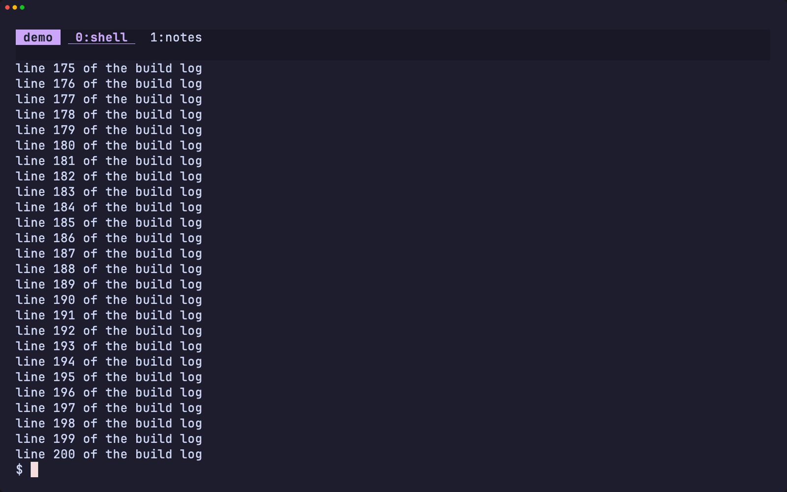
</p>

```console
$ scroll-revamped --wheel on list
set-option -g mouse on
bind-key -n WheelUpPane if-shell -F "#{?#{||:#{alternate_on},#{||:#{mouse_any_flag},#{pane_in_mode}}},1,0}" "send-keys -M" "copy-mode -e ; send-keys -X -N 5 scroll-up"
bind-key -n WheelDownPane send-keys -M
```

vim、less、htop 或 Claude Code 等在备用屏幕上运行的全屏应用会收到滚轮，请求了鼠标的应用也会收到。在 shell 提示符上，滚轮进入复制模式并滚动 tmux 历史。判断由 tmux 格式完成，因此不用列出应用名，每次滚动也不会启动进程。

---

## 快速开始

### 前提条件

| 工具 | 版本 | 用途 |
|:-----|:--------|:---------|
| tmux | 3.2 或更高 | 家族的最低版本；在 tmux 1.9 到 3.1 上也能用判断方式中的后备方案生成绑定 |
| 剪贴板工具 | 可选 | 用于 `@scroll_revamped_drag_copy` 和 `@scroll_revamped_click_copy`：macOS 上的 `pbcopy`，Linux 上的 `wl-copy`、`xclip` 或 `xsel` |
| gum | 可选 | `scroll-revamped` 的菜单、表格和颜色；没有它，所有命令都输出纯文本 |

### 安装

```tmux
set -g @plugin 'tmux-revamped/tmux-scroll-revamped'
set -g @scroll_revamped_wheel 'on'
```

然后按 `prefix + I`。不用 TPM 时，克隆仓库，并在 `~/.tmux.conf` 中运行它的入口文件：

```bash
git clone https://github.com/tmux-revamped/tmux-scroll-revamped ~/.tmux/plugins/tmux-scroll-revamped
```

```tmux
run-shell ~/.tmux/plugins/tmux-scroll-revamped/scroll-revamped.tmux
```

在克隆的目录中运行 `make install`，还会把 `scroll-revamped` 放进 `~/.local/bin`，把它的 man 手册和补全放在 `~/.local/share` 下。

### 验证

```bash
~/.tmux/plugins/tmux-scroll-revamped/bin/scroll-revamped doctor
```

## 用法

打开 `@scroll_revamped_wheel` 后直接滚动：在 vim、less、htop 等全屏应用上滚动的是应用，在 shell 提示符上滚动的是 tmux 历史。插件还会打开 tmux 的 `mouse` 选项；想自己管理时把 `@scroll_revamped_mouse` 设为 `off`。

| 命令 | 作用 |
|:--------|:-------------|
| `scroll-revamped apply` | 立即绑定滚轮；插件加载时入口点会运行它 |
| `scroll-revamped list` | 打印 apply 会做的每个绑定；`--json` 输出一个对象 |
| `scroll-revamped check ALT MOUSE HISTORY PANE` | 在 tmux 2.0 之前判断一次滚动：交给应用时以 0 退出，进入复制模式时以 1 退出 |
| `scroll-revamped doctor` | 每个依赖一行，包括剪贴板工具 |
| `scroll-revamped version` | 版本，然后是 tmux 版本 |
| `scroll-revamped help` | 帮助页；`man scroll-revamped` 记录相同的命令和设置 |
| `scroll-revamped` | 在终端上显示菜单 |

| tmux 选项 | 默认值 | 含义 |
|:------------|:--------|:--------|
| `@scroll_revamped_wheel` | `off` | `on` 绑定负责分配滚轮的根表 `WheelUpPane` 和 `WheelDownPane`；`off` 保留 tmux 自己的滚轮 |
| `@scroll_revamped_passthrough_alternate` | `on` | 把滚轮交给备用屏幕上的应用；`off` 时这些窗格也进入复制模式 |
| `@scroll_revamped_passthrough_mouse` | `on` | 把滚轮交给请求了鼠标的应用 |
| `@scroll_revamped_skip_empty` | `off` | `on` 时没有历史的窗格不进入复制模式 |
| `@scroll_revamped_select_pane` | `off` | `on` 时滚动前先选中指针下的窗格 |
| `@scroll_revamped_alt_keys` | 无 | `arrow` 或 `page` 把滚轮变成方向键或翻页键，交给关闭了鼠标的备用屏幕应用，例如 less、man 或 vi；方向键模式每次发送 `@scroll_revamped_speed` 个键，未设置时为 3，最多 20 |
| `@scroll_revamped_mouse` | `on` | `off` 时插件不设置 tmux 的 `mouse` 选项 |
| `@scroll_revamped_speed` | 无 | 复制模式中每次滚动的行数，为正整数 |
| `@scroll_revamped_granularity` | `line` | 复制模式中每次滚动的幅度：`line`、`halfpage` 或 `page` |
| `@scroll_revamped_auto_exit` | `off` | `on` 时在底部向下滚动会离开复制模式 |
| `@scroll_revamped_indicator` | `off` | `on` 时每次复制模式滚动都闪示位置，例如 `scroll 120/4000` |
| `@scroll_revamped_drag_copy` | `off` | `on` 时把复制模式中的鼠标选区复制到系统剪贴板 |
| `@scroll_revamped_click_copy` | `off` | `on` 时把双击的单词和三击的整行复制到系统剪贴板，并退出复制模式 |
| `@scroll_revamped_smooth` | `off` | `on` 时把复制模式中的一格滚动拆成多步，每步间隔 5 毫秒，20 行以内每步一行，文字平滑移动而不跳动；仅限按行滚动且速度低于 1000，需要 tmux 3.2 及以上 |
| `@scroll_revamped_status_wheel` | `off` | `on` 时在状态栏上滚动滚轮会切换窗口 |

每个选项也可以写成用短横线连接的命令选项，例如 `--skip-empty on`，以及环境变量，例如 `SCROLL_REVAMPED_SKIP_EMPTY`；命令行优先于环境变量，环境变量优先于 tmux 选项。空的 tmux 选项表示使用默认值。两个 passthrough 选项都为 `off` 时，滚轮总是进入复制模式。

<a id="判断方式"></a>

## 判断方式

`WheelUpPane` 只检查一个条件：窗格在备用屏幕上，或其应用请求了鼠标，或窗格已处于某种模式。条件成立时，滚轮事件用 `send-keys -M` 交给窗格；否则 tmux 用 `copy-mode -e` 进入复制模式，滚回底部时会自动离开。`WheelDownPane` 总是转发事件，因此滚动的是应用或已打开的复制模式。

| tmux | 分配方式 |
|:-----|:--------|
| 3.1 及以后 | 使用 `#{\|\|:}` 和 `#{&&:}` 运算符的单个格式 |
| 2.0 到 3.0 | 用嵌套的 `#{?}` 组成同一个条件 |
| 1.9 | 每次滚动都运行 `scroll-revamped check`，并按窗格状态把结果缓存在 `@scroll_revamped_cache_key` 和 `@scroll_revamped_cache_val` 中 |

速度、幅度、自动离开和位置提示在 tmux 2.4 及以后重新绑定 `copy-mode` 和 `copy-mode-vi` 表中的滚轮；位置提示需要 tmux 3.2，状态栏滚轮需要 tmux 2.1。

<a id="界面"></a>

## 界面

<details>
<summary>所有界面，在真实的 tmux 中用 <code>make screens</code> 录制，每个鼠标手势和按键显示在状态栏上</summary>
<br>

<table>
<tr>
<td width="50%" valign="top">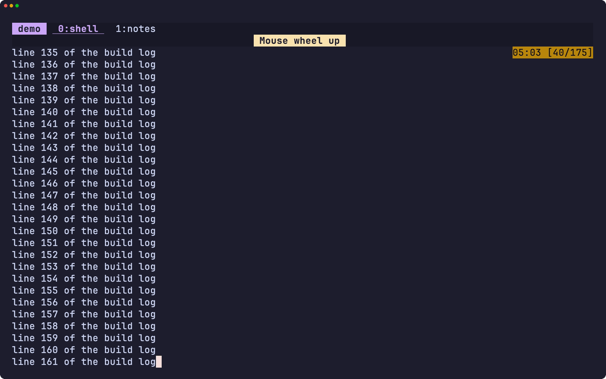<br><sub>在 shell 上滚动滚轮会进入复制模式并滚动历史，来自 <code>hero.tape</code></sub></td>
<td width="50%" valign="top">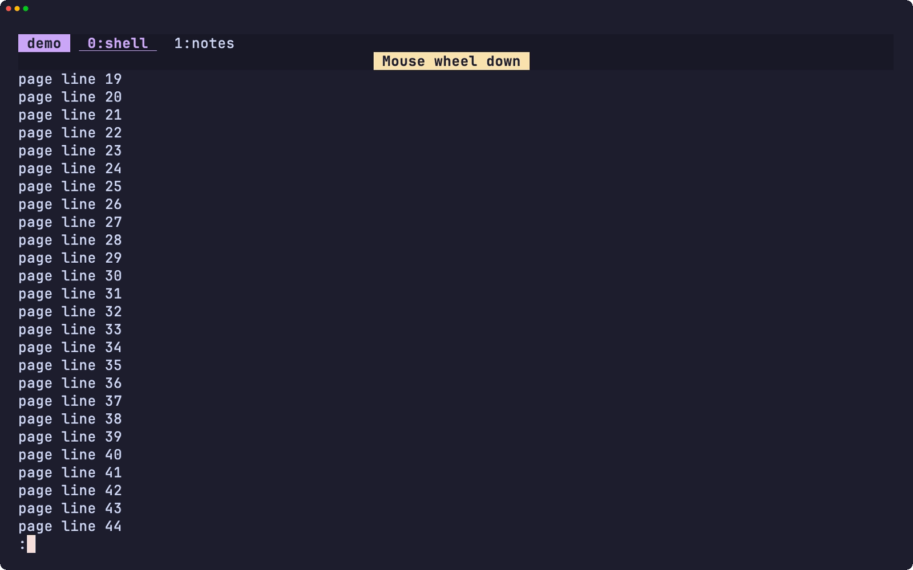<br><sub><code>@scroll_revamped_alt_keys arrow</code> 让 less 用方向键滚动，来自 <code>hero.tape</code></sub></td>
</tr>
<tr>
<td width="50%" valign="top">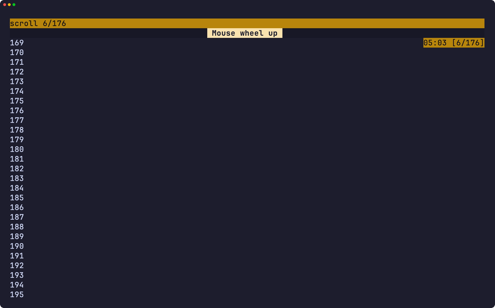<br><sub><code>@scroll_revamped_indicator</code> 闪示滚动位置，来自 <code>hero.tape</code></sub></td>
<td width="50%" valign="top"><br><sub><code>@scroll_revamped_status_wheel</code> 让状态栏上的滚轮切换窗口，来自 <code>hero.tape</code></sub></td>
</tr>
<tr>
<td width="50%" valign="top">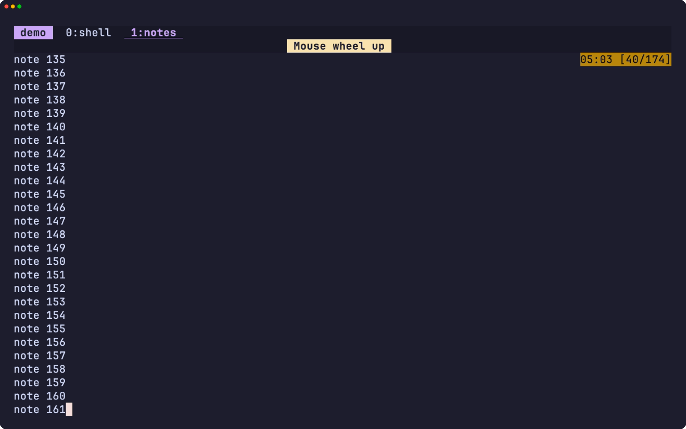<br><sub><code>@scroll_revamped_smooth</code> 把滚轮的一格拆成逐行滚动，来自 <code>hero.tape</code></sub></td>
<td width="50%" valign="top">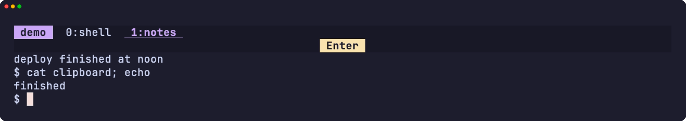<br><sub><code>@scroll_revamped_click_copy</code> 把双击的单词复制到剪贴板，来自 <code>hero.tape</code></sub></td>
</tr>
<tr>
<td width="50%" valign="top">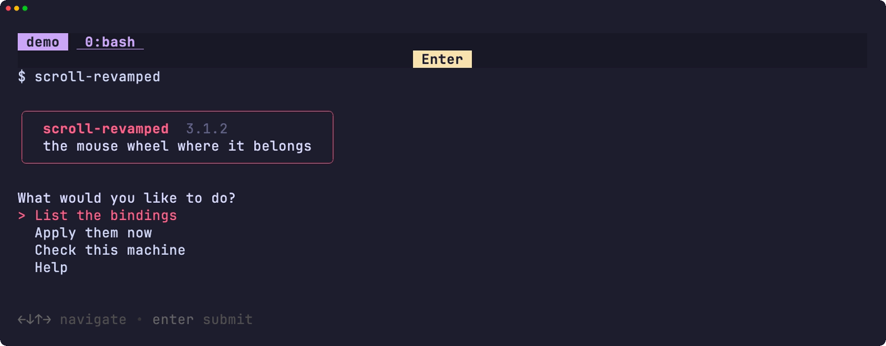<br><sub>菜单，来自 <code>stills.tape</code></sub></td>
<td width="50%" valign="top">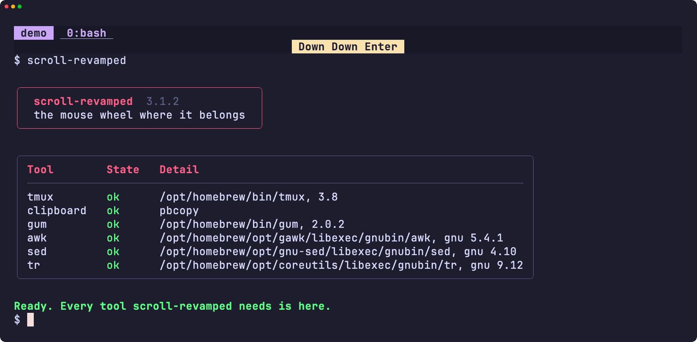<br><sub><code>doctor</code>，来自 <code>stills.tape</code></sub></td>
</tr>
<tr>
<td width="50%" valign="top">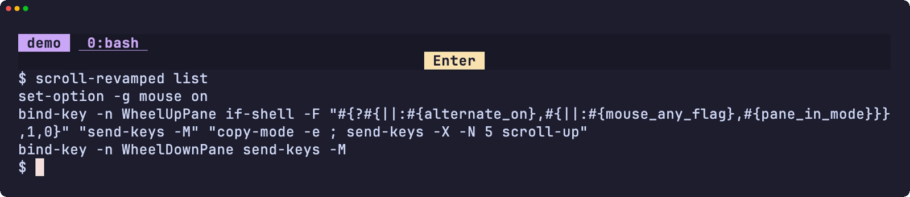<br><sub><code>list</code>，来自 <code>stills.tape</code></sub></td>
<td width="50%" valign="top">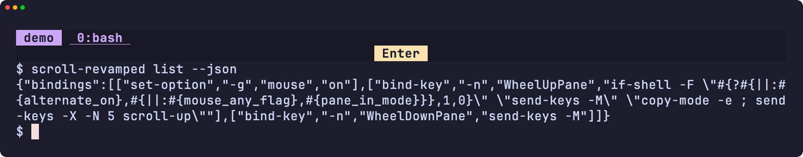<br><sub><code>list --json</code>，来自 <code>stills.tape</code></sub></td>
</tr>
<tr>
<td width="50%" valign="top">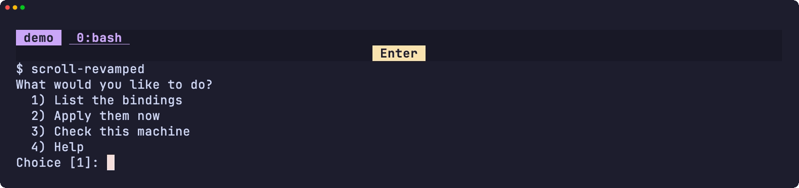<br><sub>没有 gum 的菜单，来自 <code>stills.tape</code></sub></td>
<td width="50%" valign="top">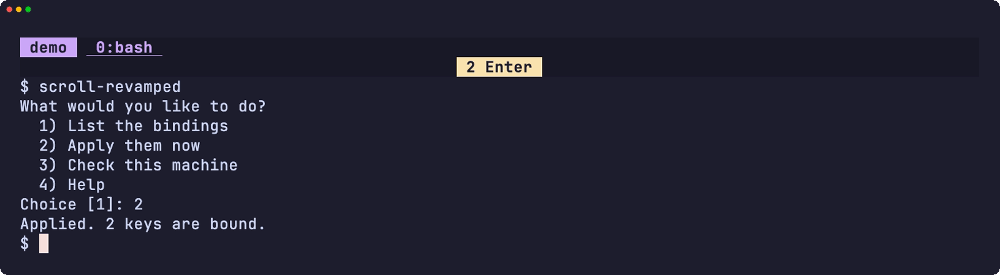<br><sub>从菜单运行 <code>apply</code>，来自 <code>stills.tape</code></sub></td>
</tr>
<tr>
<td width="50%" valign="top">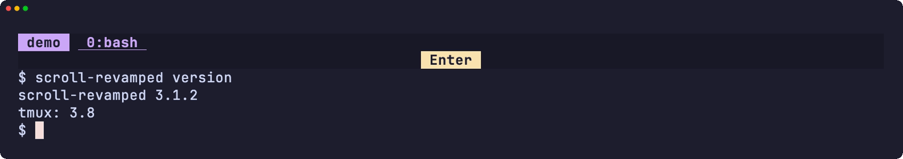<br><sub>版本，来自 <code>stills.tape</code></sub></td>
<td width="50%" valign="top">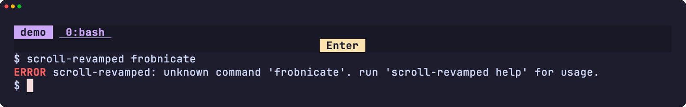<br><sub>未知命令，来自 <code>stills.tape</code></sub></td>
</tr>
<tr>
<td width="50%" valign="top">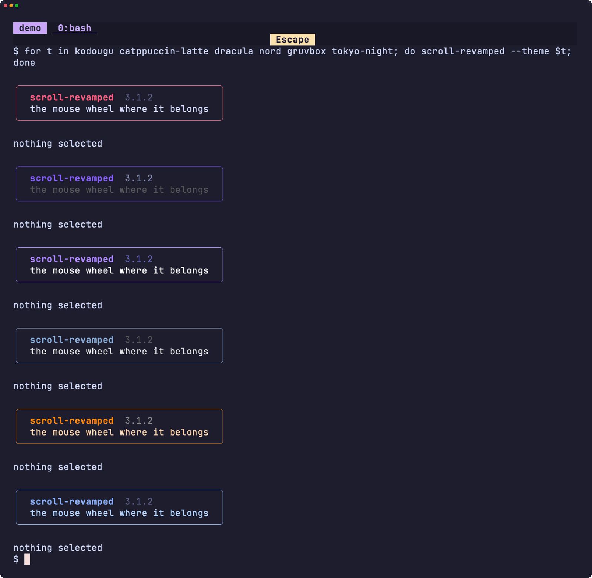<br><sub>六种主题下的标题，来自 <code>themes.tape</code></sub></td>
<td width="50%" valign="top">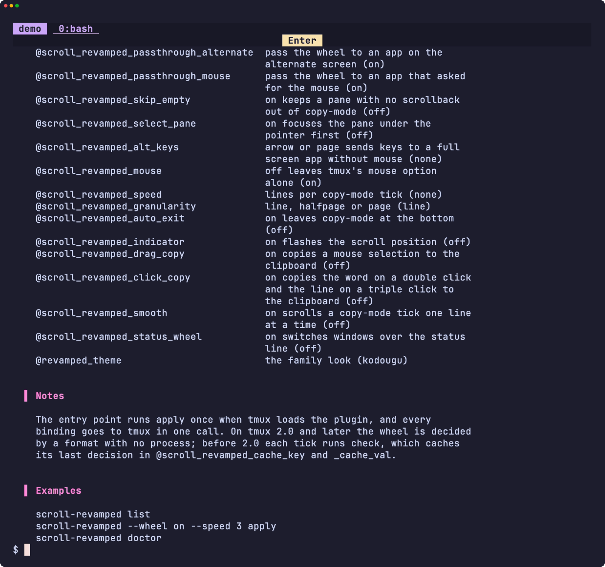<br><sub>帮助页，来自 <code>help.tape</code></sub></td>
</tr>
<tr>
<td width="50%" valign="top">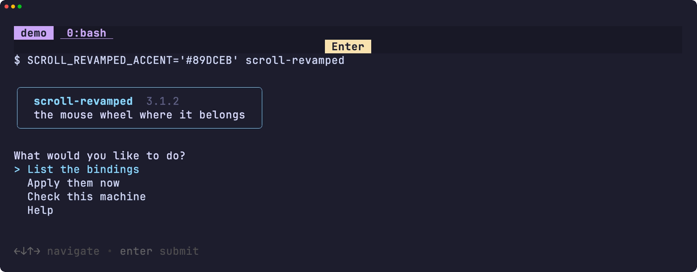<br><sub>来自 <code>SCROLL_REVAMPED_ACCENT</code> 的强调色，来自 <code>stills.tape</code></sub></td>
<td width="50%" valign="top"></td>
</tr>
</table>

</details>

## 可移植性

插件是 POSIX `sh`。CI 在下面每一行上运行全部测试。

| Shell | 状态 |
|:------|:-------|
| `dash`、macOS 上的 `/bin/sh` | 支持 |
| `bash` 3.2 和 5.x、系统自带的 `zsh` 和 Homebrew 的 `zsh` | 支持 |

| 系统 | 状态 |
|:-------|:-------|
| macOS | Apple Silicon 和 Intel 上的 Tahoe，使用系统自带的工具、Homebrew 的 GNU 工具和 Homebrew 的 uutils |
| Linux | x86_64 和 arm64 上的 Ubuntu 26.04，使用 GNU coreutils、uutils 和 BusyBox |

## 开发

| 命令 | 运行内容 |
|:--------|:-------------|
| `make fmt` | 对每个脚本运行 shfmt `-i 2` |
| `make lint` | shfmt、ShellCheck、mandoc、yamllint 和 actionlint，零告警 |
| `make test` | 在系统 `sh` 下运行 bats 测试 |
| `make test-all` | 在每个已安装的 shell 下运行测试，macOS 上包括 bash 和 zsh 的两种构建 |
| `make test-linux` | 在 Ubuntu 容器中运行测试 |
| `make coverage` | 在这台 Mac 和 Ubuntu 容器中运行 bashcov，合并后以 100% 为门槛 |
| `make screens` | 用 VHS 在 tmux 中从真实插件录制上面的界面，在 macOS 上运行 |
| `make install` | 把命令、man 手册和补全安装到 `PREFIX` 下 |

提交遵循 Conventional Commits 格式，直接进入 `main`。`main` 上的 `ci` 通过后，`release.yml` 运行 semantic-release：自上一个标签以来的每个 `feat` 或 `fix` 都会发布新版本，更新版本常量，并把说明写进 [`CHANGELOG.md`](CHANGELOG.md)。

## 许可证

[MIT](LICENSE)，copyright Gustavo Franco。

<!-- family:begin -->

## tmux-revamped 插件家族

这个插件是 tmux-revamped 插件家族的一员。每个成员都带有 [`FAMILY.md`](FAMILY.md) 中相同的约定和相同的共享库，并且设计为一起安装：没有成员占用另一个成员占用的按键或 tmux 选项。

在一个成员中发现的缺陷，要在全部成员中排查之后才算修复完成。

| 成员 | 功能 |
|---|---|
| [`tmux-autoreload-revamped`](https://github.com/tmux-revamped/tmux-autoreload-revamped) | 编辑并保存 tmux 配置后，它会自动重新加载，无需按键，也无需命令 |
| [`tmux-battery-revamped`](https://github.com/tmux-revamped/tmux-battery-revamped) | 在 tmux 状态栏显示电池状态，从不阻塞状态栏渲染 |
| [`tmux-bluetooth-revamped`](https://github.com/tmux-revamped/tmux-bluetooth-revamped) | 在 tmux 状态栏显示每个已连接的蓝牙设备及其电量，不阻塞渲染 |
| [`tmux-cpu-revamped`](https://github.com/tmux-revamped/tmux-cpu-revamped) | 在 tmux 状态栏显示 CPU 负载、温度和频率，从不阻塞渲染 |
| [`tmux-disk-revamped`](https://github.com/tmux-revamped/tmux-disk-revamped) | 在 tmux 状态栏显示磁盘用量，从不阻塞状态栏渲染 |
| [`tmux-extract-revamped`](https://github.com/tmux-revamped/tmux-extract-revamped) | 用 fzf 从屏幕上挑选 URL、路径、哈希或任意其他词元，并输入到光标处，全部用纯 shell 实现 |
| [`tmux-fzf-revamped`](https://github.com/tmux-revamped/tmux-fzf-revamped) | 在弹出窗口中的 fzf 选择器里切换、关闭、重命名或创建 tmux 会话、窗口和窗格 |
| [`tmux-git-revamped`](https://github.com/tmux-revamped/tmux-git-revamped) | 在 tmux 状态栏中显示活动窗格的 git 分支、改动和托管平台计数，且不阻塞渲染 |
| [`tmux-gpu-revamped`](https://github.com/tmux-revamped/tmux-gpu-revamped) | 在 tmux 状态栏中显示 NVIDIA、AMD、Intel 和 Apple GPU 的负载、温度、频率、功耗和显存 |
| [`tmux-kube-revamped`](https://github.com/tmux-revamped/tmux-kube-revamped) | 在 tmux 状态栏中显示当前的 Kubernetes 上下文和命名空间，不依赖 kubectl，直接解析 kubeconfig |
| [`tmux-launcher-revamped`](https://github.com/tmux-revamped/tmux-launcher-revamped) | 在弹出窗口或新窗口中启动任意 TUI 应用，从当前窗格的目录开始，每个应用可配置一个按键 |
| [`tmux-logging-revamped`](https://github.com/tmux-revamped/tmux-logging-revamped) | 将任意窗格保存到文件：实时日志、完整回滚缓冲区或一次性截图 |
| [`tmux-music-revamped`](https://github.com/tmux-revamped/tmux-music-revamped) | 在 tmux 状态栏显示正在播放的曲目，从不阻塞状态栏渲染 |
| [`tmux-network-revamped`](https://github.com/tmux-revamped/tmux-network-revamped) | 在 tmux 状态栏显示网络吞吐量，从不阻塞渲染 |
| [`tmux-pain-control-revamped`](https://github.com/tmux-revamped/tmux-pain-control-revamped) | tmux 的窗格和窗口管理按键，适配 tmux 版本，兼容 vim，每个 prefix 按键都可禁用 |
| [`tmux-persist-revamped`](https://github.com/tmux-revamped/tmux-persist-revamped) | 保存 tmux 的所有会话、窗口和窗格，按定时器自动保存，并在重启后全部恢复 |
| [`tmux-plugin-template`](https://github.com/tmux-revamped/tmux-plugin-template) | tmux-revamped 插件的起点：共享库、bats 测试框架和 CI |
| [`tmux-pomodoro-revamped`](https://github.com/tmux-revamped/tmux-pomodoro-revamped) | tmux 状态栏中的番茄钟计时器，所有状态都保存在 tmux 选项中，不使用临时文件 |
| [`tmux-ram-revamped`](https://github.com/tmux-revamped/tmux-ram-revamped) | 在 tmux 状态栏显示内存、交换空间和内存压力，在后台采样，渲染从不等待 |
| [`tmux-reorder-revamped`](https://github.com/tmux-revamped/tmux-reorder-revamped) | 用鼠标在 tmux 状态栏上拖动窗口标签来移动该窗口 |
| [`tmux-scroll-revamped`](https://github.com/tmux-revamped/tmux-scroll-revamped) | **本插件**，将鼠标滚轮交给能自行滚动的应用，其他情况下进入 tmux 复制模式 |
| [`tmux-sensible-revamped`](https://github.com/tmux-revamped/tmux-sensible-revamped) | 按 tmux 版本和终端区分的合理默认设置，不改动你自己设置的选项 |
| [`tmux-tiling-revamped`](https://github.com/tmux-revamped/tmux-tiling-revamped) | tmux 的平铺窗口管理：八种布局，包括 BSP dwindle 和 spiral，并支持撤销布局 |
| [`tmux-time-revamped`](https://github.com/tmux-revamped/tmux-time-revamped) | 状态栏中的本地时钟和世界时钟，按一天中的时段着色，并提供倒计时和夏令时提醒 |
| [`tmux-weather-revamped`](https://github.com/tmux-revamped/tmux-weather-revamped) | 在后台从 wttr.in 获取天气并显示在状态栏，状态栏无需等待 |

<!-- family:end -->
